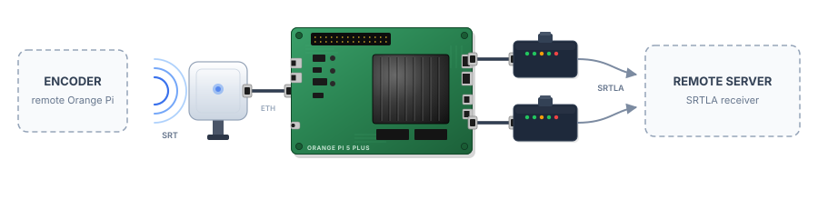

# Belabox Duo

Řídicí aplikace založená na Bun pro streamování s agregací připojení ve stylu [BELABOX](https://belabox.net/). Jeden program podporuje tři typy zařízení a volitelný řídicí server umožňuje spravovat celou jejich skupinu prostřednictvím webového prohlížeče.

[](https://github.com/majklovec/belabox-duo/actions)
[](https://bun.sh)
[](https://www.typescriptlang.org)

> [!WARNING]
> Vývoj stále probíhá — nepoužívejte pro produkční streamování.

<p align="center">
  
</p>

## Role

Jeden spustitelný program, tři typy zařízení. Roli vyberte pomocí `--role`:

| Role              | Funkce                                                                                                                                                                                                                                                             |
| ----------------- | ------------------------------------------------------------------------------------------------------------------------------------------------------------------------------------------------------------------------------------------------------------------ |
| `relay` (výchozí) | Přijímá SRT stream z enkodéru a distribuuje jej přes všechna dostupná připojení pomocí [srtla_send](https://github.com/irlserver/srtla_send). Spravuje směrování podle zdrojové adresy, soubor s uplinky a modemy (ModemManager).                                  |
| `encoder`         | Spouští [belacoder](https://github.com/BELABOX/belacoder) nebo [ceracoder](https://github.com/CERALIVE/ceracoder) s GStreamer pipeline a odesílá SRT stream do relé. Nezajišťuje směrování, správu modemů ani `srtla_send` — nepotřebuje oprávnění uživatele root. |
| `combined`        | Enkodér a relé v jednom zařízení: enkodér → lokální `srtla_send` → agregovaná připojení. Jedno tlačítko Start/Stop ovládá obě části.                                                                                                                               |

```text
encoder ──SRT──▶ relay ──SRTLA (agregovaný stream)──▶ SRTLA přijímač
combined ─────────SRTLA (agregovaný stream)─────────▶ SRTLA přijímač
        ▲                    ▲
        └── řídicí server (volitelný, WebSocket) ───┘
```

### Požadavky

-   [Bun](https://bun.sh)
-   `srtla_send` (relay, combined)
-   `belacoder`/`ceracoder` a GStreamer (encoder, combined)
-   `iproute2` a ModemManager (`mmcli`) pro agregaci připojení a správu modemů

## První spuštění

```sh
# Relé: lokální webové rozhraní + API na portu 8085, sleduje síťová rozhraní a znovu načítá srtla_send
sudo bun backend/client/client.ts --host 0.0.0.0

# Enkodér: vyberte pipeline a SRT port relé ve webovém rozhraní
bun backend/client/client.ts --role encoder --pipelines /usr/share/belacoder/pipelines

# Kombinované zařízení
sudo bun backend/client/client.ts --role combined --pipelines /usr/share/belacoder/pipelines

# Relé: spustí srtla_send ihned při startu
sudo bun backend/client/client.ts --start-srtla 6000 rec.example.com 5000
```

Otevřete `http://<device>:8085/`. Rozhraní zobrazuje pouze funkce relevantní pro zvolenou roli.

Pokud používáte lokální kopii projektu s přibalenými binárními soubory, nastavte jejich cesty explicitně:

```sh
sudo CONTROL_SERVER_TOKEN=token \
  ENCODER_BIN=./belacoder \
  SRTLA_SEND_BIN=./srtla_send \
  bun backend/client/client.ts --port 8085 \
  --remote ws://127.0.0.1:8090/device \
  --role combined --pipelines ./pipeline
```

> [!NOTE]
> Používejte `CONTROL_SERVER_TOKEN`, nikoli `REMOTE_TOKEN` — klient čte první z těchto proměnných. Přiřazení proměnných **za příkazem `sudo`** předá jejich hodnoty spuštěnému příkazu, aniž by bylo nutné nastavovat trvalé proměnné prostředí shellu.

### Parametry

| Parametr                  | Proměnná prostředí     | Výchozí hodnota                  | Poznámka                                                                                                                              |
| ------------------------- | ---------------------- | -------------------------------- | ------------------------------------------------------------------------------------------------------------------------------------- |
| `--role`                  | `ROLE`                 | `relay`                          | `relay`, `encoder`, `combined`                                                                                                        |
| `--host`, `--port`        |                        | `127.0.0.1`, `8085`              | Lokální webové rozhraní a WebSocket API (`/ws`), vždy aktivní                                                                         |
| `--allow-origin`          |                        |                                  | Další povolené originy pro `/ws` (oddělené čárkami, `*` = libovolný)                                                                  |
| `--config`                |                        | `$TMPDIR/config.json`            | Konfigurace zařízení — nastavení, enkodér, cíl SRTLA, automatické spuštění a modemy. **V produkčním provozu použijte trvalou cestu.** |
| `--uplinks`               |                        | `$TMPDIR/srtla_ips.txt`          | Soubor s uplinky pro `srtla_send`                                                                                                     |
| `--start-srtla`           |                        |                                  | Pro relay/combined: spustí `srtla_send` při startu pomocí parametrů `<listenPort> <remoteHost> <remotePort>`                          |
| `--srtla-reload`          |                        | `signal`                         | `signal` (SIGHUP) nebo `restart`                                                                                                      |
| `--srtla-socket`          | `SRTLA_CONTROL_SOCKET` | `$TMPDIR/srtla_send.sock`        | Řídicí socket `srtla_send` (statistiky připojení, režim a kvalita); `""` jej deaktivuje                                               |
| `--debounce-ms`           |                        | `1500`                           | Prodleva pro sloučení událostí síťových rozhraní                                                                                      |
| `--pipelines`             | `PIPELINES_DIR`        | `/usr/share/belacoder/pipelines` | Soubory pipeline včetně podadresářů                                                                                                   |
| `--encoder`               | `ENCODER_BIN`          | `belacoder`                      | Binární soubor enkodéru; pokud název odpovídá `ceracoder`, automaticky se aktivuje režim konfigurace INI                              |
|                           | `SRTLA_SEND_BIN`       | `srtla_send`                     | Cesta k binárnímu souboru `srtla_send`                                                                                                |
| `--bitrate-file`          |                        | `$TMPDIR/belacoder_br`           | Soubor s datovým tokem belacoder; znovu se načítá při SIGHUP                                                                          |
| `--ceracoder-conf`        |                        | `$TMPDIR/ceracoder.conf`         | Konfigurace INI pro ceracoder (balancer a ladění parametrů), kterou modul enkodéru aplikuje za běhu                                   |
| `--log-file`              |                        | `$TMPDIR/srtla_log.json`         | Trvalý protokol událostí zobrazovaný ve webovém rozhraní                                                                              |
| `--remote`                | `CONTROL_SERVER_URL`   |                                  | Řídicí server, např. `wss://ctl.example.com/device`                                                                                   |
| `--remote-token`          | `CONTROL_SERVER_TOKEN` |                                  | Upřednostněte proměnnou prostředí, aby token nebyl viditelný ve výpisu procesů `ps`                                                   |
| `--remote-interval`       |                        | `30`                             | Interval odesílání stavových informací v sekundách (`0` = pouze při změně)                                                            |
| `--remote-stats-interval` |                        | `2`                              | Interval odesílání statistik připojení `srtla_send` na řídicí server v sekundách (`0` = vypnuto)                                      |
| `--dry-run`               |                        |                                  | Vypisuje akce `ip` a procesů, místo aby je skutečně prováděl                                                                          |

### Průvodce prvotním nastavením

Pokud zařízení ještě nemá konfigurační soubor `--config`, zobrazí se místo běžného rozhraní **průvodce prvotním nastavením**. Umožňuje nastavit jazyk, roli, identitu zařízení (název hostitele a barvu záhlaví), připojení k řídicímu serveru (URL a token), parametry enkodéru (pipeline, datový tok, zvuk) a u rolí relay/combined také cíl SRTLA a možnosti plánovače.

Uložení (`setup.complete`) ověří zadané údaje, vytvoří počáteční konfigurační soubor, připojí se k řídicímu serveru a spustí funkce příslušné zvolené roli. Poté se již zobrazuje běžné rozhraní a průvodce se znovu nenabízí.

### Pipeline enkodéru

Pipeline jsou soubory GStreamer používané programem belacoder, uložené v adresáři zadaném pomocí `--pipelines` a uspořádané do podadresářů (`generic/`, `rk3588/`, `jetson/` atd.). Před spuštěním se pipeline upraví obdobně jako v belaUI: vybere se zvuková karta ALSA (nebo se zvuk vypne), AAC se případně nahradí kodekem Opus a provedou se další potřebné úpravy.

Každý soubor pipeline musí obsahovat neprázdný řetězec příkazů GStreamer. Prázdné soubory nebo soubory obsahující pouze bílé znaky jsou odmítnuty ještě před spuštěním belacoderu. Pokud rozhraní zobrazí chybu `Pipeline is empty`, vyberte jinou pipeline nebo obnovte obsah souboru.

Vybraná pipeline musí odpovídat dostupnému hardwaru a nainstalovaným zásuvným modulům GStreamer. Například pipeline pro Rockchip používají `mpph265enc`, který není dostupný na běžném počítači s procesorem x86.

Stránka nastavení umožňuje také spravovat **repozitáře pipeline na GitHubu** ve formátu `author/repository`. Soubory v adresáři `pipeline/` daného repozitáře se rekurzivně importují do `PIPELINES_DIR/author/repository/`.

U každého nakonfigurovaného repozitáře se zobrazuje počet pipeline. Repozitář lze aktualizovat přímo na místě (obnoví se pouze daný repozitář) nebo odstranit — při odstranění se smažou také importované soubory pipeline. Funkce **Update all** aktualizuje všechny nakonfigurované repozitáře a nahradí jejich místní soubory, takže se odstraní i pipeline, které již ve zdrojových repozitářích neexistují.

Pod seznamem repozitářů se nachází **správce pipeline**, který pracuje se soubory na disku. Zobrazuje všechny pipeline seskupené podle podadresářů a umožňuje vytvářet nové soubory, upravovat jejich příkazy GStreamer nebo je mazat.

Nové soubory se ukládají do `PIPELINES_DIR` pod zvolenou cestou. Aby bylo možné soubor uložit, musí obsahovat neprázdný řetězec příkazů GStreamer s alespoň jedním oddělovačem `!` mezi prvky pipeline.

### Automatické spuštění

V rozhraní zaškrtněte **Autostart** nebo zavolejte `autostart.set`. Při každém spuštění služby se tím obnoví poslední stream.

Pokud ještě není připravena snímací karta, uplinky nebo přijímač, aplikace se pokusí stream spustit znovu každých 5 sekund. Jakýkoli ruční příkaz Start nebo Stop čekající opakování zruší.

## Řídicí server

Soubor `backend/server/server.ts` zobrazuje seznam všech zařízení a zpřístupňuje stejné webové rozhraní každému zařízení na adrese `/d/<id>/`. Příkazy přeposílá zařízení prostřednictvím jeho odchozího spojení, takže lze spravovat i zařízení za NAT nebo připojená přes mobilní síť.

Server rovněž poskytuje jednotlivým uživatelům vlastní **nástěnky (dashboards)**. Ty využívají mřížky Gridstack složené z widgetů libovolných zařízení vlastněných daným uživatelem a mají samostatné stránky pro přidávání, úpravy a zobrazení.

Widgety jsou dvojího druhu:

-   **Widgety zařízení** — živá stavová karta pro každé zařízení: `relay`, `encoder`, `combined` nebo `obs`, podle jeho role a povolených modulů.
-   **Widgety kanálů** — na zařízení nezávislé moduly. Jeden centrální hub pro každý typ modulu obsluhuje všechny widgety daného typu.

Nástěnky se ukládají do databáze SQLite (tabulka `dashboards` v souboru `--db`) a společný živý datový tok (`/dashboards/ws`) průběžně předává data widgetů do všech otevřených zobrazení.

### Ověřování uživatelů

Server nahrazuje HTTP Basic autentizaci uživatelskými profily uloženými v místní databázi **SQLite** (`bun:sqlite`). Každý profil má přihlašovací heslo pro webový prohlížeč a jeden nebo více tokenů zařízení.

-   **Uživatelé** jsou uloženi v databázi SQLite (výchozí soubor `users.db`, viz `--db`). Hesla jsou ukládána jako hashe algoritmu **scrypt** — hesla v otevřeném textu se nikdy neukládají na disk.
-   **Zařízení** se ověřují pomocí hlavičky `Authorization: Bearer <token>` při navazování spojení `ws://<server>/device`. Server přiřadí token uživateli a zařízení přiřadí tomuto uživateli. Zařízení tedy patří profilu, jehož token použilo.
-   **Prohlížeče** se přihlašují na `/login` pomocí uživatelského jména a hesla. Po úspěšném přihlášení server nastaví relační cookie `HttpOnly`. Seznamy zařízení, stránky zařízení i nástěnky jsou následně omezeny na daného uživatele. Uživatel vidí pouze svá zařízení a pouze on může otevřít jejich stránku či WebSocket a upravovat své nástěnky.
-   **`/register`** vytváří nový účet. První účet se automaticky vytvoří jako administrátorský, bez pozvánkového kódu. Každý další účet vyžaduje platný jednorázový **pozvánkový kód**, který může mít datum vypršení platnosti a který vytvoří administrátor. Nové profily nemají žádné tokeny zařízení — přidávají se na stránce profilu po přihlášení.
-   **`/profile/`** (dostupná z nabídky uživatelského jména v záhlaví) umožňuje změnit přihlašovací heslo a spravovat tokeny zařízení — přidávat nové a odstraňovat staré. Administrátoři mají navíc panel pro vytváření nových pozvánek a prohlížení historie kódů.
-   **`--no-auth`** přesměruje všechny operace na jeden místní profil pro testování. Není potřeba databáze (nástěnky zůstávají pouze v paměti).

```sh
# Řídicí server — první účet se vytvoří na /register
bun backend/server/server.ts --port 8090

# Na každém zařízení — token vlastníka daného zařízení
CONTROL_SERVER_TOKEN=tok-alice-1 bun backend/client/client.ts --role encoder --remote wss://ctl.example.com/device

# V prohlížeči
open http://ctl.example.com/  # přesměruje na /login; zadejte uživatelské jméno a heslo
```

| Parametr           | Proměnná prostředí | Poznámka                                                                       |
| ------------------ | ------------------ | ------------------------------------------------------------------------------ |
| `--host`, `--port` |                    | Výchozí hodnota `0.0.0.0:8090`                                                 |
| `--db`             | `SRTLA_DB`         | Databáze SQLite: uživatelé, tokeny zařízení, nástěnky (výchozí `users.db`)     |
| `--no-auth`        |                    | Pouze pro místní testování — jeden sdílený profil `local`, bez nutnosti tokenů (databáze se nevyužívá; nástěnky zůstávají pouze v paměti) |

> [!IMPORTANT]
> Server provozujte za reverzní TLS proxy — tokeny zařízení a relační cookie vyžadují `wss://` a `https://`.

## Nasazení

### systemd

Spouštějte zkompilované binární soubory (`bun run build:client` / `bun run build:server`) jako službu. Příklad jednotky pro zařízení (`/etc/systemd/system/belabox-duo.service`):

```ini
[Unit]
Description=Belabox Duo device
After=network-online.target
Wants=network-online.target

[Service]
ExecStart=/usr/local/bin/bun /opt/belabox-duo/client --config /var/lib/belabox-duo/config.json
Restart=always
User=root

[Install]
WantedBy=multi-user.target
```

Řídicí server se nastavuje obdobně, pouze místo `client` použijte `server` (oprávnění root nejsou potřeba). Roli, URL řídicího serveru, token a cesty k binárním souborům nastavte v konfiguračním souboru `--config` nebo v souboru `EnvironmentFile`.

Zařízení uchovává stav v cestě určené parametrem `--config`. Tato cesta musí být trvalá, aby automatické spuštění fungovalo i po restartu.

### Obraz Armbian (Orange Pi 5 Plus)

Adresář [`armbian/`](armbian/) obsahuje nástroje pro nativní sestavení připraveného obrazu Armbian pro streamování přímo na hostitelském počítači:

-   `setup-host.sh` — jednorázová instalace závislostí potřebných pro sestavení (spouštějte jako root).
-   `build.sh [config]` — stáhne sestavovací framework Armbian, propojí přibalený adresář `userpatches/` a sestaví obraz. Výchozí konfigurace je `orangepi5-plus`.
-   `build-all.sh` — sestaví obě varianty: obraz pro SD kartu a obraz pro automatickou instalaci na **eMMC** (`orangepi5-plus-emmc`), který při prvním spuštění zkopíruje systém na eMMC pomocí jednorázové služby `belabox-emmc-install.service`.

Obraz obsahuje celý řetězec pro streamování: GStreamer (včetně `gstreamer1.0-rockchip1`), SRT od CERALIVE, [ceracoder](https://github.com/CERALIVE/ceracoder) (sestavený ze zdrojových kódů), [srtla_send](https://github.com/irlserver/srtla_send) (předpřipravený balíček `.deb` pro arm64) a pravidla udev pro zvuk v belaUI.

Díky tomu lze `backend/client/client.ts --role combined` spustit bez další konfigurace.

### Docker

Soubor `docker-compose.yaml` spouští celý systém — řídicí server, relé, enkodér a proxy pro OBS Studio (viz `Dockerfile` a `Dockerfile.device`):

```sh
docker compose up -d --build
```

-   **server** — `backend/server/server.ts`, řídicí server (`Dockerfile`, obraz `majkl/belabox-duo-control`), webové rozhraní na portu `8090`.
-   **obs-client** — `backend/obs-client/obs-client.ts`, zpřístupňuje OBS Studio hostitelského počítače (`ws://host.docker.internal:4455`) prostřednictvím serveru; používá stejný obraz jako řídicí server, ale jiný vstupní bod.
-   **relay** — `backend/client/client.ts --role relay`, agreguje SRT stream pomocí `srtla_send` (`Dockerfile.device`, obraz `majkl/belabox-duo-device`).
-   **encoder** — `backend/client/client.ts --role encoder`, spouští `ceracoder`/GStreamer a odesílá SRT do relé; používá stejný obraz zařízení, ale jinou roli a proměnnou `ENCODER_BIN`.

Obraz zařízení pro relé a enkodér obsahuje `backend/client/client.ts`, nativní binární soubory `srtla_send`, `ceracoder` a `belacoder`, definice GStreamer pipeline a nástroje `iproute2`.

**Relé** vyžaduje oprávnění `NET_ADMIN` nastavené pomocí `cap_add`, protože při startu vytváří pravidla směrování podle jednotlivých uplinků (`ip rule add` a směrovací tabulky) a sleduje síťová rozhraní pomocí `ip monitor`. Bez tohoto oprávnění relé zaznamená chybu `ip rule add … Operation not permitted` a skončí.

Enkodér toto oprávnění nepotřebuje. Při použití výchozí síťové konfigurace bridge se změny směrování relé týkají pouze síťového jmenného prostoru kontejneru, nikoli hostitele. Pokud chcete skutečně agregovat připojení přes fyzická síťová rozhraní hostitele, spusťte relé s `network_mode: host`.

## API

Lokální koncový bod `/ws` a řídicí server používají stejný JSON protokol:

-   Požadavek — `{ "id", "method", "params" }`
-   Odpověď — `{ "type": "response", "id", "ok", … }`
-   Událost — `{ "type": "event", "event": "status" | "log" | "srtla.stats", "data": … }`

Seznam metod je uveden na začátku souboru [`backend/client/methods.ts`](backend/client/methods.ts). Metody, které neodpovídají roli daného zařízení, jsou odmítnuty s kódem 409.

Ikona ozubeného kola v záhlaví zařízení otevírá stránku nastavení. Ta používá `settings.get` a `settings.update` pro správu trvalého UUID zařízení, názvu hostitele, role, URL řídicího serveru, vzdáleného tokenu, barvy záhlaví a jazyka rozhraní.

UUID představuje neměnnou identitu zařízení na řídicím serveru. Přidělí se automaticky, uloží se do konfiguračního souboru a již se nemění — přetrvá i při změně názvu hostitele.

Uložením nastavení se znovu naváže spojení s řídicím serverem. Zařízení se tak zaregistruje s novou URL, tokenem, názvem hostitele a rolí, aniž by bylo nutné restartovat službu.

Nastavení streamu (pipeline, datový tok, zvuk, cíle a plánovač) se ukládají automaticky při každé změně.

## Moduly

Každá funkce je implementována jako **samostatný modul** v adresáři [`modules/`](modules/README.md). Modul obsahuje registraci backendu, kartu frontendového rozhraní, vlastní typy a styly.

Jádro aplikace (`backend/` + `frontend/`) nikdy nenačítá modul přímo podle jeho identifikátoru. Moduly vyhledává, směruje a vykresluje prostřednictvím registrů a sběrnice schopností. Toto oddělení ověřuje test [`test/registries.test.ts`](test/registries.test.ts).

Webová aplikace je ve složce `frontend/`, spustitelné vstupní body jsou oddělené pod `backend/client/`, `backend/obs-client/` a `backend/server/`. Adresáře modulů zůstávají pohromadě v kořenové složce `modules/`; sdílené wire typy jsou ve `shared/`.

### Moduly zařízení

Běží přímo na zařízení a každý se zobrazuje jako karta ve webovém rozhraní.

| Modul            | Funkce                                                                                                                                                                                                                                                                                                                                                                                                                                                              |
| ---------------- | ------------------------------------------------------------------------------------------------------------------------------------------------------------------------------------------------------------------------------------------------------------------------------------------------------------------------------------------------------------------------------------------------------------------------------------------------------------------- |
| `encoder`        | Spouští a spravuje proces enkodéru pro zařízení `encoder` a `combined`. Vyhledává pipeline (jejich identifikátory jsou cesty pod `--pipelines`, např. `rk3588/h265_hdmi_1440p25`), zajišťuje spuštění a automatické restartování a umožňuje měnit datový tok za běhu. Podporuje **belacoder** (datový tok se nastavuje pomocí souboru s minimální a maximální hodnotou, který se znovu načítá při SIGHUP) a **ceracoder** (konfigurace INI s nastavením balanceru). |
| `srtla`          | Spravuje proces `srtla_send` na zařízeních `relay` a `combined`: spuštění, zastavení a opětovné načtení (SIGHUP nebo restart). Umožňuje také průběžně měnit parametry plánovače (režim a kvalitu) přes řídicí socket.                                                                                                                                                                                                                                               |
| `modems`         | Integrace s ModemManagerem (`mmcli`): detekce modemů, stav každého modemu, kvalita signálu, operátor a ovládání zapnutí, vypnutí, resetu, připojení a odpojení. Výběr modemů je propojen s konfigurací agregace připojení.                                                                                                                                                                                                                                          |
| `obs-controller` | Spravuje spojení `obs-websocket` verze 5 ([obs-websocket](https://github.com/obsproject/obs-websocket)) s propojenou instancí OBS Studio a předává její události do proudu událostí zařízení. Zajišťuje také **přepínač při nízkém datovém toku**: stavový automat ([`switcher-engine.ts`](modules/obs-controller/switcher-engine.ts)), který sleduje metriky SRT/OBS a přepíná OBS mezi scénami `normal`, `low` a `offline`.                                       |

### Widgety kanálů

Jsou určeny pouze pro nástěnky a běží na řídicím serveru nezávisle na konkrétním zařízení. Jeden centrální hub každého modulu obsluhuje všechny widgety daného typu.

| Widget       | Zdroj a funkce                                                                                                                                                                                                                                                                                                                                                                                                                                                                                                                                                                                                                                                                                                                                                                                                                                                                                              |
| ------------ | ----------------------------------------------------------------------------------------------------------------------------------------------------------------------------------------------------------------------------------------------------------------------------------------------------------------------------------------------------------------------------------------------------------------------------------------------------------------------------------------------------------------------------------------------------------------------------------------------------------------------------------------------------------------------------------------------------------------------------------------------------------------------------------------------------------------------------------------------------------------------------------------------------------- |
| `stats`      | Umožňuje samostatně nastavit kanály YouTube (ID kanálu nebo handle), Twitch a Kick. Každých 30 sekund načítá počty diváků a zobrazuje každou platformu i jejich součet v grafu za poslední hodinu.                                                                                                                                                                                                                                                                                                                                                                                                                                                                                                                                                                                                                                            |
| `chat`       | Jeden widget zobrazuje sloučený chat ze všech nakonfigurovaných platforem. Konfigurace obsahuje kanál pro každou platformu (`youtube`, `twitch`, `tiktok`, `kick`) a všechny vyplněné kanály se připojí; jejich zprávy se slučují do jednoho zobrazení. Komunikační mechanismy jednotlivých platforem jsou v `modules/chat/providers/`: Kick se připojuje k veřejné chatovací místnosti Pusher bez autentizace, Twitch používá jedno spojení IRC přes WebSocket pro každý kanál (anonymní přezdívka `justinfan`, značky IRCv3), YouTube dotazuje endpoint živého chatu pro každý identifikátor tvůrce přibližně každou sekundu pomocí [`youtube-chat-next`](https://www.npmjs.com/package/youtube-chat-next) a TikTok používá jedno WebSocket spojení prostřednictvím [`tiktok-live-connector`](https://www.npmjs.com/package/tiktok-live-connector), přičemž opětovné připojování zajišťuje samotný modul. |

Widgety chatu uchovávají průběžnou historii zpráv, aby se při opětovném připojení neposílaly znovu, a používají množinu `seen` k odstranění duplicit podle ID zpráv i po opětovném připojení.

### Jak funguje systém modulů

Každý adresář `modules/<id>/` obsahuje přesně čtyři soubory:

-   `backend.ts` — registrace backendu (běží v Bun na hostiteli, bez DOM).
-   `frontend.tsx` — registrace frontendu (komponenty Mithril, bez importů z backendu).
-   `types.ts` — pouze lokální typy daného modulu (může importovat typy jádra, nikdy však typy jiného modulu).
-   `styles.css` — styly omezené na `.mod-<id>` (karta zařízení) nebo `.dash-card` (widget).

**Registrační kontrakt** je definován strukturou. Backend deklaruje `id`, `configSchema`, podle kterého rozhraní vytvoří konfigurační formulář, `secretFields` pro skrytí citlivých údajů, uspořádané seznamy `methods` a `events`, funkce `start`/`stop`/`dispatch`, volitelný fragment `status()`, volitelnou mapu `services.capabilities`, volitelný hub widgetu a `dependencies`.

Frontend používá stejnou identitu a navíc poskytuje komponentu widgetu `component`, obsah karty zařízení `cardBody(host, status)` a rozhraní pro připojení hubu a příjem dat widgetů. Podrobné tabulky jednotlivých polí jsou v [`modules/README.md`](modules/README.md).

**Vyhledávání modulů** — backend při běhu prochází adresáře `modules/*/` pomocí `readdirSync` v souboru [`shared/registry.ts`](shared/registry.ts). Stačí přidat adresář a modul bude nalezen. Prohlížeč nemůže při běhu automaticky procházet soubory, proto `scripts/gen-modules.ts` vytváří manifest `generated/modules.frontend.ts`, který je ignorován Gitem a vychází ze stejného seznamu. Generování je zapojeno do `predev`.

**Propojení jádra a modulů** — RPC metody se směrují prostřednictvím mapy vlastníků metod v registru, která vzniká z pole `methods` každého modulu. Rozhraní načítá karty a widgety pomocí přístupových funkcí v [`frontend/ts/module-registry.ts`](frontend/ts/module-registry.ts). Služby mezi moduly komunikují přes **sběrnici schopností (capability bus)**: modul zaregistruje schopnost pod názvem s tečkovou notací, například `stream.encoder` nebo `stream.srtla`, a ostatní moduly ji vyhledají podle názvu prostřednictvím [`backend/client/capabilities.ts`](backend/client/capabilities.ts), místo aby ji přímo importovaly.

Každý modul načítá svůj soubor `styles.css` jako vedlejší efekt importu, takže jádro nemusí vybírat CSS jednotlivých modulů podle jejich identifikátorů.

**Pořadí modulů** — funkce `resolveOrder` řadí moduly topologicky podle jejich `dependencies`. Je bezpečná i při výskytu cyklů a moduly bez vzájemných závislostí řadí podle ID. Funkce `startModules`, `stopModules` a `buildStatus` toto pořadí vždy respektují; nepoužívají ručně udržovaný seznam.

**Přidání modulu** — vytvořte `modules/<id>/` se čtyřmi uvedenými soubory, zaregistrujte `cardBody` pro zařízení nebo `component` a `createHub` pro widget a případně nastavte `dependencies`. Jádro není nutné upravovat — modul se objeví díky automatickému procházení adresářů a kroku `predev`.

Názvy metod a událostí jsou pevně dané. Jejich přejmenování představuje nekompatibilní změnu API.

### Klient OBS

Soubor [`backend/obs-client/obs-client.ts`](backend/obs-client/obs-client.ts) představuje **samostatné zařízení** určené pro počítače, na kterých běží OBS Studio odděleně od relé.

Registruje se na řídicím serveru stejně jako `backend/client/client.ts` (má stabilní UUID a v úvodní zprávě uvádí `role: "obs"`) a zprostředkovává komunikaci mezi webovými nástěnkami a OBS.

```sh
bun backend/obs-client/obs-client.ts --obs ws://127.0.0.1:4455 \
  --obs-password secret \
  --remote ws://10.0.0.5:8090/device --remote-token secret
```

Klient implementuje kompletní úvodní komunikaci protokolu obs-websocket v5 (`Hello` → `Identify` → `Identified`), beze změny předává požadavky `Request` a `RequestBatch` ze serveru, přiřazuje odpovědi podle ID požadavků a publikuje události OBS jako zprávy `obs.event`. Nástěnky tak mohou zobrazovat změny scén, streamování a nahrávání.

Při výpadku se automaticky znovu připojuje s exponenciálně rostoucí prodlevou. Při odpojení emituje syntetickou událost `ObsDisconnected` a po opětovném připojení přehraje snímek stavu ve formě událostí odpovídajících skutečným zprávám OBS.

Stejná knihovna `ObsClient` (`shared/obs/client.ts`) se používá také přímo v modulu `obs-controller`, takže relé s lokálním OBS nepotřebuje druhé WebSocket spojení.

## Vývoj

```sh
bun install

# Řídicí server (webové rozhraní se sestaví při spuštění)
bun run dev

# Testy
bun test

# Sestavení samostatných binárních souborů
bun run build:client     # → dist/client
bun run build:server     # → dist/server
bun run build:obs-client # → dist/obs-client
```

Moduly se vyhledávají za běhu procházením adresáře `modules/`. Generované manifesty v `generated/` vytváří `scripts/gen-modules.ts`; tento krok je zapojen do `predev`, `pretest` a `prebuild:*`.

Uživatelské rozhraní podporuje více jazyků prostřednictvím JSON katalogů v `i18n/` (12 jazyků). Překlady se podle potřeby poskytují prohlížeči z adresy `/i18n/<lang>.json`. Jazyk se nastavuje při prvním spuštění a lze jej kdykoli změnit pomocí výběru v záhlaví. Zařízení si volbu ukládá do konfiguračního souboru.

## Poděkování

-   [BELABOX](https://github.com/BELABOX) / [belabox.net](https://belabox.net/) od rationalirl — projekt protokolu agregovaného streamování, na kterém toto řešení staví. [Podpořte projekt](https://github.com/sponsors/rationalirl).
-   [CERALIVE/ceracoder](https://github.com/CERALIVE/ceracoder)
-   [irlserver/srtla_send](https://github.com/irlserver/srtla_send)
