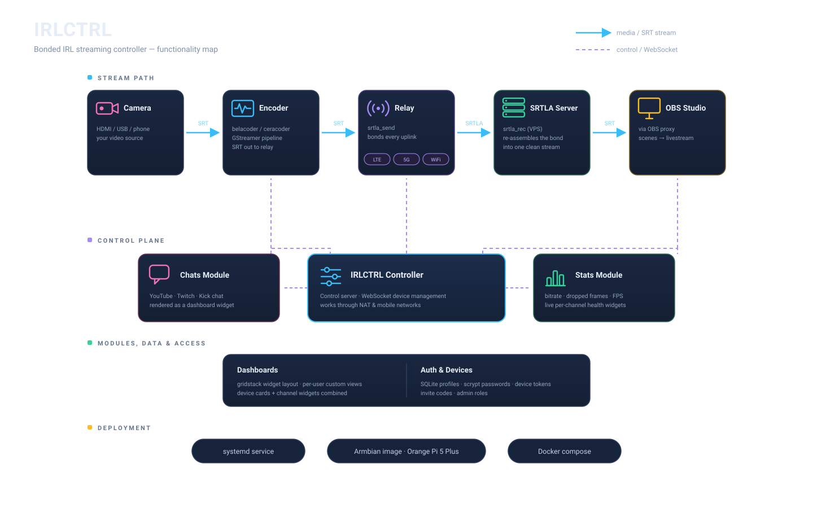

<div align="center">


# IRLCTRL

Bun-based controller for [BELABOX](https://belabox.net/)-style bonded streaming. One module-driven device client runs the selected role, and an optional control server manages a fleet from a browser.

[](https://github.com/majklovec/irlctrl/actions)
[](https://github.com/majklovec/irlctrl/releases)
[](https://bun.sh)
[](https://www.typescriptlang.org)

</div>

<p align="center">
  
</p>

## Roles

One device client, module-contributed roles selected with `--role`:

| Role              | What it does                                                                                                                                                                                                               |
| ----------------- | -------------------------------------------------------------------------------------------------------------------------------------------------------------------------------------------------------------------------- |
| `relay` (default) | Receives SRT from an encoder and bonds it out over all uplinks with [srtla_send](https://github.com/irlserver/srtla_send). Manages source routing, the uplinks file, and ModemManager devices.                                 |
| `encoder`         | Runs [belacoder](https://github.com/BELABOX/belacoder) or [ceracoder](https://github.com/CERALIVE/ceracoder) with a GStreamer pipeline and sends SRT to a relay. No routing, ModemManager, or `srtla_send` — does not need root. |
| `combined`        | Encoder and relay in one box: encoder → local `srtla_send` → bonded uplinks. One Start/Stop drives both.                                                                                                                   |
| `obs`             | Connects to a paired OBS Studio instance, forwards its events, and runs the low-bitrate scene switcher.                                                                                                                         |
| `broadcaster`     | Receives SRTLA with `srtla_rec` and publishes one or more RTMP outputs through ffmpeg.                                                                                                                                           |

```
encoder ──SRT──▶ relay ──SRTLA (bonded)──▶ SRTLA receiver
combined ─────────SRTLA (bonded)─────────▶ SRTLA receiver
        ▲                ▲
        └── control server (optional, WebSocket) ──┘
```

### Requirements

-   [Bun](https://bun.sh)
-   `srtla_send` (relay, combined)
-   `belacoder`/`ceracoder` and GStreamer (encoder, combined)
-   `iproute2` and ModemManager (`mmcli`) for bonding and modem management
-   `srtla_rec` and ffmpeg (broadcaster)
-   OBS Studio with obs-websocket v5 (obs)

## Getting started

```sh
# Relay: local web UI + API on :8085, watches interfaces, reloads srtla_send
sudo bun backend/client/client.ts --host 0.0.0.0

# Encoder: pick a pipeline and the relay's SRT port in the UI
bun backend/client/client.ts --role encoder --pipelines /usr/share/belacoder/pipelines

# Combined
sudo bun backend/client/client.ts --role combined --pipelines /usr/share/belacoder/pipelines

# Relay: also start srtla_send immediately on startup
sudo bun backend/client/client.ts --start-srtla 6000 rec.example.com 5000
```

Open `http://<device>:8085/`. The UI shows only what applies to the role.

For a local checkout with the bundled binaries, override their paths explicitly:

```sh
sudo CONTROL_SERVER_TOKEN=token \
  ENCODER_BIN=./belacoder \
  SRTLA_SEND_BIN=./srtla_send \
  bun backend/client/client.ts --port 8085 \
  --remote ws://127.0.0.1:8090/device \
  --role combined --pipelines ./pipeline
```

### Options

Every flag has an environment-variable counterpart. Resolution order: **CLI flag > env var > config file > default**.

| Option                    | Env                             | Default                          | Notes                                                                                                                |
| ------------------------- | ------------------------------- | -------------------------------- | -------------------------------------------------------------------------------------------------------------------- |
| `‑‑role`                  | `ROLE`                          | `relay`                          | A role contributed by a registered module (`relay`, `encoder`, `combined`, `obs`, `broadcaster`)                      |
| `‑‑host`, `‑‑port`        | `API_HOST`, `API_PORT`          | `127.0.0.1`, `8085`              | Local web UI and WebSocket API (`/ws`), always on                                                                    |
| `‑‑allow‑origin`          | `ALLOWED_ORIGINS`               |                                  | Extra browser origins for `/ws` (comma-separated, `*` = any)                                                         |
| `‑‑config`                | `CONFIG_FILE`                   | `$TMPDIR/config.json`            | Device config — core settings, module settings and state. **Use a persistent path in production**                 |
| `‑‑uplinks`               | `UPLINKS_FILE`                  | `$TMPDIR/srtla_ips.txt`          | Uplinks file for `srtla_send`                                                                                        |
| `‑‑start‑srtla`           |                                 |                                  | Relay/combined: start `srtla_send` on boot with `<listenPort> <remoteHost> <remotePort>`                             |
| `‑‑srtla‑reload`          | `SRTLA_RELOAD_MODE`             | `signal`                         | `signal` (SIGHUP) or `restart`                                                                                       |
| `‑‑srtla‑socket`          | `SRTLA_CONTROL_SOCKET`          | `$TMPDIR/srtla_send.sock`        | `srtla_send` control socket (link stats, mode/quality); `""` disables it                                             |
| `‑‑debounce‑ms`           | `DEBOUNCE_MS`                   | `1500`                           | Interface-event debounce                                                                                             |
| `‑‑pipelines`             | `PIPELINES_DIR`                 | `/usr/share/belacoder/pipelines` | Pipeline files, including subdirectories                                                                             |
| `‑‑encoder`               | `ENCODER_BIN`                   | `belacoder`                      | Encoder binary; `ceracoder` is detected by name and switches the encoder module to INI-config mode                   |
|                           | `SRTLA_SEND_BIN`                | `srtla_send`                     |                                                                                                                      |
| `‑‑bitrate‑file`          | `BITRATE_FILE`                  | `$TMPDIR/belacoder_br`           | belacoder bitrate file (re-read on SIGHUP)                                                                           |
| `‑‑ceracoder‑conf`        | `CERACODER_CONF`                | `$TMPDIR/ceracoder.conf`         | ceracoder INI config (balancer + tuning), applied live by the encoder module                                         |
| `‑‑log‑file`              | `LOG_FILE`                      | `$TMPDIR/srtla_log.json`         | Persistent event log shown in the web UI                                                                             |
| `‑‑remote`                | `CONTROL_SERVER_URL`            |                                  | Control server, e.g. `wss://ctl.example.com/device`                                                                  |
| `‑‑remote‑token`          | `CONTROL_SERVER_TOKEN`          |                                  | Prefer the env var (keeps it out of `ps`)                                                                           |
| `‑‑remote‑interval`       | `CONTROL_SERVER_INTERVAL`       | `30`                             | Periodic status push in seconds (`0` = only on change)                                                               |
| `‑‑remote‑stats‑interval` | `CONTROL_SERVER_STATS_INTERVAL` | `2`                              | `srtla_send` link-stats push to the control server in seconds (`0` = off)                                            |
| `‑‑dry‑run`               | `DRY_RUN`                       |                                  | Print `ip`/process actions instead of running them                                                                   |

### First-run setup wizard

A fresh device (no `--config` file yet) opens on a **setup wizard** instead of the regular UI: language, role, identity (hostname + header color), control-server connection (URL + token), encoder settings (pipeline, bitrate, audio) and — for relay/combined — the SRTLA target and scheduler options. Saving (`setup.complete`) validates everything, writes the initial config file, dials the control server, and brings the role up. From then on the normal UI is shown, and the wizard is never offered again.

### Encoder pipelines

Pipelines are the belacoder GStreamer files under `--pipelines`, grouped by subdirectory (`generic/`, `rk3588/`, `jetson/`, …). Before launch the pipeline is adapted the way belaUI does: choose the ALSA audio card (or drop audio), switch AAC to Opus, and so on.

Every pipeline file must contain a non-empty GStreamer launch string — empty or whitespace-only files are rejected before belacoder starts (select another pipeline, or restore the file, if the UI reports `Pipeline is empty`). The selected pipeline must also match the available hardware and GStreamer plugins on the device; for example the Rockchip pipelines use `mpph265enc`, which is not available on a generic x86 host.

The settings page can also manage **GitHub pipeline repositories** in `author/repository` format. Files below the repository's `pipeline/` directory are imported recursively into `PIPELINES_DIR/author/repository/`. Each configured repository shows a **pipeline count** badge, and can be **updated** in place (refreshing just that repository) or **removed** — removing a repository also deletes its imported pipeline files. **Update all** refreshes every configured repository, replacing its local files so deleted upstream pipelines are removed too.

Below the repository list is a **pipeline manager** for the files on disk: it lists every pipeline grouped by subdirectory and lets you **create** a new pipeline file, **edit** its GStreamer launch string, or **delete** it. New files are written under `PIPELINES_DIR` at the path you choose; a file must contain a non-empty GStreamer launch string (with at least one `!` between elements) to be saved.

### Autostart

Tick **Autostart** in the UI (or call `autostart.set`) to resume the last stream whenever the service starts. It retries every 5 s until it succeeds (capture card, uplinks, or receiver not ready yet); any manual Start/Stop cancels a pending retry.

## Control server

`backend/server/server.ts` lists all devices and serves the same web UI for each one at `/d/<id>/`, relaying commands to the device over its outbound connection — so devices behind NAT or on mobile networks can be managed. It also hosts per-user **dashboards**: gridstack grids composed of widgets from any device owned by that user, with dedicated add / edit / view pages. Widgets come in three kinds — **device widgets** (bound to one device: live status cards for `relay`, `encoder`, `combined`, `obs`, or `broadcaster`, depending on the device's role and enabled modules), **channel widgets** (device-independent modules, one hub per kind serves all widgets of that kind) and **fleet widgets** (offered once, driving any of your devices: the `buttons` virtual StreamDeck). Dashboards are persisted to the SQLite database (`dashboards` table of `--db`), and a shared live feed (`/dashboards/ws`) streams widget data to every open view.

### Authentication

The server replaces HTTP Basic auth with per-user profiles stored in a local **SQLite** database (`bun:sqlite`). Each profile has a login **password** (browser) and one or more **device tokens**.
-   **Users** live in the SQLite database (default `users.db`, see `--db`). Passwords are stored as **scrypt hashes** — the plaintext never touches disk.
-   **Devices** authenticate with `Authorization: Bearer <token>` when they open their `ws://<server>/device` connection. The server resolves the token to a user and assigns the device to that user — devices are therefore owned by the profile whose token presented them.
-   **Browsers** sign in at `/login` with the username and password. A successful login sets an `HttpOnly` session cookie; all device lists, device pages, and dashboards are then scoped to that user. Only devices owned by the signed-in user are visible, and only that user can open a device's page/WS or edit its dashboards.
-   **`/register`** creates a new account. The **first** account is bootstrapped as admin without an invite code; every account after that needs a valid, single-use **invitation code** (optionally expiring) minted by an admin. New profiles start with no device tokens — add them on the profile page after signing in.
-   **`/profile`** (reached from the username menu in the header) changes the login password and lists/manages the user's device tokens — adding new ones and removing old ones. Admins additionally get an **invitations panel** to mint fresh invite codes and review the code history.
-   `--no-auth` maps everything to a single local profile for local testing (no database needed; dashboards are kept in memory only).

```sh
# control server — the first account is created at /register
bun backend/server/server.ts --port 8090

# on each device — that device's owner token
CONTROL_SERVER_TOKEN=tok-alice-1 bun backend/client/client.ts --role encoder --remote wss://ctl.example.com/device

# in a browser
open http://ctl.example.com/  # redirects to /login; enter the username + password
```

| Option             | Env           | Notes                                                                                                               |
| ------------------ | ------------- | ------------------------------------------------------------------------------------------------------------------- |
| `‑‑host`, `‑‑port` | `SERVER_HOST`, `SERVER_PORT` | Default `0.0.0.0:8090`                                                                                              |
| `‑‑db`             | `DB_FILE`     | SQLite database: users, device tokens, dashboards (default `users.db`)                                              |
| `‑‑no‑auth`        | `NO_AUTH`     | Local testing only — one shared `local` profile, no tokens needed (no database; dashboards are kept in memory only) |

> [!IMPORTANT]
> Run the server behind a TLS reverse proxy — device tokens and the session cookie need `wss://`/`https://`.

### Install as an app (PWA)

The control-server UI is an installable web app: every page links a web app manifest (`frontend/pwa/manifest.webmanifest`, bundled with the pages) and registers a service worker served at the origin root (`/sw.js`, scope `/`, from `frontend/pwa/` via [`shared/pwa.ts`](shared/pwa.ts) — embedded in the compiled binary). On a phone open the server over **HTTPS**, sign in, then _Add to Home Screen_ (iOS Safari: Share → Add to Home Screen; Android Chrome: menu → Install app / Add to Home screen). Desktop Chrome/Edge show an install icon in the address bar.

The service worker caches only the app shell: the hashed `/assets/*` bundles and the icons cache-first, page navigations network-first with the last good copy as an offline fallback. It never touches `/api/*`, `/i18n/*`, the device connection (`/device`) or any websocket (`…/ws`), so live data, RPC and dashboards behave exactly as before. Service workers need a secure context — plain `http://` (other than `localhost`) just skips the registration.

## Deployment

### systemd

Run the compiled binaries (`bun run build:client` / `bun run build:server`) as a service. Example device unit (`/etc/systemd/system/irlctrl.service`):

```ini
[Unit]
Description=IRLCTRL device
After=network-online.target
Wants=network-online.target

[Service]
ExecStart=/usr/local/bin/bun /opt/irlctrl/client --config /var/lib/irlctrl/config.json
Restart=always
User=root

[Install]
WantedBy=multi-user.target
```

The control server is the same with `server` in place of `client` (no `root` needed). Put role, control-server URL/token, and binary overrides in the config file (`--config`) or an `EnvironmentFile`; the device keeps its state in the `--config` path, which autostart needs to survive a reboot.

### Armbian image (Orange Pi 5 Plus)

[`armbian/`](armbian/) builds a ready-to-stream **Armbian** image natively on the host:
-   `setup-host.sh` — one-time install of the build dependencies (run as root)
-   `build.sh [config]` — clones the Armbian build framework, links the bundled `userpatches/`, and compiles the image (default config `orangepi5-plus`)
-   `build-all.sh` — builds both variants: the SD-card image and the **eMMC auto-install** image (`orangepi5-plus-emmc`), which copies itself to eMMC on first boot via a one-shot `irlctrl-emmc-install.service`

The image ships with the whole streaming chain — GStreamer (incl. `gstreamer1.0-rockchip1`), CERALIVE's SRT, [ceracoder](https://github.com/CERALIVE/ceracoder) (built from source), [srtla_send](https://github.com/irlserver/srtla_send) (prebuilt arm64 .deb), and udev rules for belaUI audio — so `backend/client/client.ts --role combined` runs out of the box.

### Docker

`docker-compose.yaml` runs the whole stack — the control server plus a relay, an encoder, an OBS role device, and a broadcaster role device (see `Dockerfile` and `Dockerfile.device`):

```sh
docker compose up -d --build
```

-   **server** — `backend/server/server.ts`, the control server (`Dockerfile`, image `majkl/irlctrl-control`), UI on `:8090`.
-   **obs-client** — the standard `backend/client/client.ts --role obs` process with the `obs-controller` module enabled; connects to host OBS at `ws://host.docker.internal:4455`.
-   **relay** — `backend/client/client.ts --role relay`, bonds SRT out via `srtla_send` (`Dockerfile.device`, image `majkl/irlctrl-device`).
-   **encoder** — `backend/client/client.ts --role encoder`, runs `ceracoder`/GStreamer and sends SRT to the relay; same device image, different role + `ENCODER_BIN`.
-   **broadcaster** — `backend/client/client.ts --role broadcaster` runs the `modules/broadcaster` receiver and publisher with ffmpeg; configure destinations in the device settings and expose SRTLA UDP port `5001`.

The shared device image bundles `backend/client/client.ts`, the native streaming binaries, ffmpeg, GStreamer, and the role modules. The **relay** grants the `NET_ADMIN` capability (`cap_add`) because at startup it builds per-uplink policy routing (`ip rule add` + route tables) and watches interfaces with `ip monitor`; without it the relay logs `ip rule add … Operation not permitted` and exits. The encoder and OBS role do not need the capability. On the default bridge network the relay's routing changes act on the container's own network namespace, not the host; for real bonded uplinks on the host's raw interfaces, run the relay with `network_mode: host`.

## API

The local `/ws` endpoint and the control server speak the same JSON protocol:
-   request — `{ "id", "method", "params" }`
-   response — `{ "type": "response", "id", "ok", … }`
-   push — `{ "type": "event", "event": "status" | "log" | "srtla.stats", "data": … }`

The method list lives at the top of [`backend/client/methods.ts`](backend/client/methods.ts). Methods that do not apply to the device's role are rejected with code 409.

The cog in the device header opens a settings page. It uses `settings.get` / `settings.update` for the persistent device UUID, hostname, role, control-server URL, remote token, header color, and UI language. The UUID is the device's fixed identity on the control server — auto-assigned once, saved in the config file, and never changed (it survives hostname changes). Saving settings re-dials the control server, so the device re-registers with its new URL, token, hostname, and role without a service restart. Stream settings (pipeline, bitrate, audio, targets, scheduler) are saved automatically whenever they change.

## Modules

Every capability is a **self-contained module** under [`modules/`](modules/README.md) — a backend registration, a frontend card, local types, and styles. The core (`backend/` + `frontend/` + `shared/`) contains no module-specific code: it discovers, routes, and renders everything through the registration contract, the registries and the capability bus. The boundary is enforced by [`test/registries.test.ts`](test/registries.test.ts).

The browser application lives in `frontend/`; service entrypoints are
separated under `backend/client/` and `backend/server/`.
Module directories stay together under `modules/<id>/` so each module's backend
and frontend implementation remain co-located. Cross-layer wire types live in
`shared/`.

**Device modules** — run on the device, each shown as a card in the web UI:

| Module           | What it does                                                                                                                                                                                                                                                                                                                                                                                            |
| ---------------- | ------------------------------------------------------------------------------------------------------------------------------------------------------------------------------------------------------------------------------------------------------------------------------------------------------------------------------------------------------------------------------------------------------- |
| `encoder`        | Runs and supervises the encoder process for encoder/combined devices: pipeline discovery (ids are paths under `--pipelines`, e.g. `rk3588/h265_hdmi_1440p25`), start/stop with automatic restart, and live bitrate changes. Supports **belacoder** (bitrate via a min/max file, re-read on SIGHUP) and **ceracoder** (INI config with balancer tuning).                                                 |
| `srtla`          | Owns relay/combined SRTLA: `srtla_send` lifecycle, scheduler options, source routing, uplink selection and ModemManager (`mmcli`) integration, including modem state and enable/disable/reset/connect/disconnect actions.                                                                                                                                                                                     |
| `ssh`            | Manages the box's sshd (start/stop) and the SSH login account password.                                                                                                                                                                                                                                                                                                                                 |
| `obs-controller` | Owns the [obs-websocket](https://github.com/obsproject/obs-websocket) (v5) connection to a paired OBS Studio instance and forwards its events into the device event stream. Also runs the **low-bitrate switcher**: a pure state machine ([`switcher-engine.ts`](modules/obs-controller/switcher-engine.ts)) that watches SRT/OBS metrics and switches OBS between `normal` / `low` / `offline` scenes. |
| `broadcaster`    | Owns the `srtla_rec` + ffmpeg stream lifecycle, output destinations, keepalive telemetry, and non-destructive profile seeding for the `broadcaster` role.                                                                                                                                                                                                                                      |

**Channel widgets** — dashboard-only, run on the control server (device-independent); one hub per module serves all widgets of its kind:

| Widget  | Source                                                                                                                                                                                                                                                                                                                                                                                                                                                                                                                                                                                                                                                                                        |
| ------- | --------------------------------------------------------------------------------------------------------------------------------------------------------------------------------------------------------------------------------------------------------------------------------------------------------------------------------------------------------------------------------------------------------------------------------------------------------------------------------------------------------------------------------------------------------------------------------------------------------------------------------------------------------------------------------------------- |
| `stats` | Configure YouTube (channel ID or handle), Twitch, and Kick channels independently. Polls each configured source every 30 s and charts each viewer count plus their combined total (1 h window).                                                                                                                                                                                                                                                                                                                                                                                                                                                                                               |
| `chat`  | One widget, one merged feed: config has a channel per platform (`youtube`, `twitch`, `tiktok`, `kick`) and every filled channel is joined, its messages merged into the single view. Per-platform transports live in `modules/chat/providers/`: Kick joins the public chat Pusher room (no auth), Twitch one IRC-over-websocket connection per channel (anonymous `justinfan` nick, IRCv3 tags), YouTube polls the live-chat endpoint per creator handle (~1 s cadence) via [`youtube-chat-next`](https://www.npmjs.com/package/youtube-chat-next), TikTok one [`tiktok-live-connector`](https://www.npmjs.com/package/tiktok-live-connector) websocket (reconnect loop owned by the module). |

Chat widgets keep rolling message history so reconnects don't re-send, and a `seen` set that dedupes message ids across reconnects.

**Buttons widget** (`modules/buttons/`) — a **virtual StreamDeck**, offered once per dashboard (under _Independent_): a grid of buttons where each button fires one RPC method of one module on one of your devices (`encoder.stop`, a bitrate preset, `srtla.reload`, an OBS `StartStream`, …) — one widget can mix buttons from any number of devices. Modules declare the actions they offer with `dashboardActions` on their backend registration — a fixed list, or a `status => …` factory for actions that depend on live device state (e.g. one mute button per OBS audio source); the control server resolves them against the device's freshest status and merges the enabled modules' actions into each device's cached status (`status.actions`), and the widget's settings (pencil icon in edit mode) compose the layout from the catalogues of all your devices — with per-button label / icon overrides and a JSON params override (e.g. `pipeline`, `host`, `port` for `encoder.start`). Actions marked `confirm` ask before firing; buttons whose device went away or whose module was disabled are shown as unavailable. See [modules/README.md → Dashboard actions](modules/README.md#dashboard-actions) for declaring actions in a module.

### How the module system works

Each `modules/<id>/` is a plugin the core discovers by directory; it ships:
-   `backend.ts` — the backend registration (runs in Bun on the host; no DOM). It parses its own CLI arguments, owns its config sections, validates and answers its own RPC methods, and contributes status / settings / setup / log wording / pages / widgets through the hooks of the contract in [`shared/module-contract.ts`](shared/module-contract.ts).
-   `frontend.tsx` — the frontend registration (mithril components; no backend imports): the device card, dashboard widgets, setup steps, device-list columns and event handlers (contract in [`frontend/ts/module-contracts.ts`](frontend/ts/module-contracts.ts)).
-   `types.ts` (its own wire types), `styles.css`, `i18n/<lang>.json` (its own translations), optional `settings.tsx` (settings-page card), `log.ts` (log wording shared by both sides), `pages/*.html` (module-owned pages), and any private helpers.

**Discovery** — the backend is a runtime `readdirSync` scan of `modules/*/` in [`shared/registry.ts`](shared/registry.ts) (compiled binaries use the generated manifest): add a directory and it appears. The browser bundle cannot glob at runtime, so `scripts/gen-modules.ts` writes the gitignored `generated/modules.*.ts` manifests from the same scan (wired into `predev`).

**Core ↔ module** — the core knows only the contract. The device lifecycle ([`backend/client/modules.ts`](backend/client/modules.ts)) starts the modules that serve the current role (`roles`), routes every non-core RPC method to its owner's `dispatch` (rejecting it with 409 outside the module's roles, or while a `requireEnabled` module is disabled), deep-merges the modules' `status()` fragments into the `status` payload, seeds and backfills their settings slices from `configDefaults`, runs their `setup()` validators in the first-run wizard and their `resume()` on autostart. Modules receive one process-services bag ([`backend/client/module-core.ts`](backend/client/module-core.ts): state, saveState, logEvent, run, Supervisor, …) and talk to each other only over the **capability bus** by name (`stream.srtla`) — never by import. Module pushes go through `ctx.emit(event, data, { throttle, retain, summary })`; the control server stores retained frames and merges `summary` fields into its device list without knowing the event.

**Persistence** — `config.json` holds the core settings plus each module's own sections (`state.data.<section>`, e.g. `encoder` and `srtla`) in the current format.

**Ordering** — `resolveOrder` topologically sorts modules by their `dependencies` (cycle-safe, id-sorted when no edges); start/stop/status/resume all iterate that order, never a hand-maintained list.

**Adding a module** — `mkdir modules/<id>` with `backend.ts` + `frontend.tsx` (+ `types.ts`, `styles.css`), declare `roles`, `methods`, hooks and capabilities as needed. No core edits — the scan and `predev` pick it up. Method and event names are frozen: renaming one is a breaking API change.

## Development

```sh
bun install

# control server (bundles the web UI on startup)
bun run dev

# tests
bun test

# compiled single-file binaries
bun run build:client     # → dist/client
bun run build:server     # → dist/server
```

Modules are discovered by a runtime scan of `modules/`; generated manifests in `generated/` are produced by `scripts/gen-modules.ts` (wired into `predev`/`pretest`/`prebuild:*`). The UI is localized via JSON catalogs (12 languages): the core strings in `i18n/` and each module's own in `modules/<id>/i18n/`, merged and served to the browser on demand as `/i18n/<lang>.json` (compiled binaries inline them through the generated `generated/i18n.ts`). The language is chosen in the first-run wizard and can be switched at any time from the header select; the device persists the choice in its config file.

The control-server build hook bundles the browser pages and embeds their generated assets in the standalone server binary; source-mode startup continues to bundle the UI from `frontend/`.

### Control-server code

[`backend/server/server.ts`](./backend/server/server.ts) remains the CLI entrypoint. Its implementation lives in
[`backend/server/`](./backend/server/):
-   [`db.ts`](./backend/server/db.ts) opens the SQLite database and runs the migrations; [`migrations/`](./backend/server/migrations/) holds the numbered `.sql` files that build the schema (each applied once, tracked in the `schema_migrations` table) — to change the schema, add a new migration file there.
-   [`auth.ts`](./backend/server/auth.ts) owns passwords, sessions, profiles, device tokens and invitations.
-   [`devices.ts`](./backend/server/devices.ts) owns the device registry, request forwarding, cached telemetry/logs and device-list broadcasts.
-   [`dashboards.ts`](./backend/server/dashboards.ts) owns dashboard validation, persistence, API responses and widget-hub synchronization.
-   [`shared/frontend.ts`](./shared/frontend.ts) bundles the UI at startup in source mode; compiled builds serve matching pages and embedded assets generated by [`gen-control-server-assets.ts`](./scripts/gen-control-server-assets.ts).
-   [`control-server.ts`](./backend/server/control-server.ts) composes the domains, HTTP routes, WebSocket handlers and maintenance timers.
-   [`contracts.ts`](./backend/server/contracts.ts) holds shared socket data, topics and event framing.

The domains receive their dependencies explicitly: authentication resolves device
tokens, the registry supplies device ownership checks to dashboards, and the
composition layer supplies publishing. Domain modules do not import the entrypoint
or each other.

## Credits

-   [BELABOX](https://github.com/BELABOX) / [belabox.net](https://belabox.net/) by rationalirl — the bonded-protocol project this builds on. [Support the effort](https://github.com/sponsors/rationalirl)
-   [CERALIVE/ceracoder](https://github.com/CERALIVE/ceracoder)
-   [irlserver/srtla_send](https://github.com/irlserver/srtla_send)
