# IRLCTRL — Uživatelská provozní příručka

Tato příručka vysvětluje, jak IRLCTRL **spustit**, **obsluhovat** a **nastavit**. IRLCTRL je nástroj postavený na Bun pro streamování ve stylu [BELABOX](https://belabox.net/) s agregací více síťových připojení. Jeden program podporuje tři typy zařízení a volitelný ovládací server umožňuje spravovat celou jejich skupinu v prohlížeči.

Všechny snímky obrazovky v této příručce byly pořízeny ze skutečně běžící instance a nacházejí se ve [`docs/screenshots/`](screenshots/).

---

## Obsah

1. [Přehled](#1-přehled)
2. [Role](#2-role)
3. [Požadavky](#3-požadavky)
4. [Spuštění softwaru](#4-spuštění-softwaru)
5. [Průvodce prvním spuštěním](#5-průvodce-prvním-spuštěním)
6. [Uživatelské rozhraní zařízení — běžná obsluha](#6-uživatelské-rozhraní-zařízení--běžná-obsluha)
7. [Stránka nastavení zařízení — všechny možnosti](#7-stránka-nastavení-zařízení--všechny-možnosti)
8. [Vysvětlení voleb enkodéru](#8-vysvětlení-voleb-enkodéru)
9. [Vysvětlení voleb relay / SRTLA](#9-vysvětlení-voleb-relay--srtla)
10. [Modul OBS Studio & přepínač nízkého bitrate](#10-modul-obs-studio--přepínač-nízkého-bitrate)
11. [Obsluha ovládacího serveru](#11-obsluha-ovládacího-serveru)
12. [Reference příkazové řádky](#12-reference-příkazové-řádky)
13. [Řešení problémů](#13-řešení-problémů)

---

## 1. Přehled

IRLCTRL zachycuje živý přenos na zařízení s rolí **encoder** a pomocí [`srtla_send`](https://github.com/irlserver/srtla_send) jej odesílá přes několik síťových připojení (modemy, Wi‑Fi nebo Ethernet). Díky tomu výpadek jednoho slabého připojení nemusí přenos přerušit. Volitelný **ovládací server** propojuje a spravuje zařízení z webového prohlížeče.

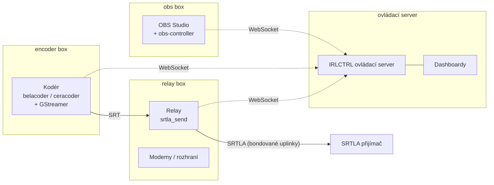

Nejjednodušší nasazení nabízí role **combined** (kombinovaná): enkodér a relay běží na jednom zařízení, stream se z enkodéru předává přímo místní instanci `srtla_send` a jediné tlačítko Start/Stop ovládá obě části.

Typická topologie:

```
encoder ──SRT──▶ relay ──SRTLA (bonded)──▶ SRTLA receiver
combined ─────────SRTLA (bonded)─────────▶ SRTLA receiver
        ▲                ▲
        └── ovládací server (volitelný, WebSocket) ──┘
```

### Hlavní části programu

| Část | Vstupní bod | Co to je |
| --- | --- | --- |
| **Klient zařízení** | `backend/client/client.ts` | Běží na každém zařízení s rolí encoder, relay nebo combined. Zpřístupňuje místní webové rozhraní a API na portu **8085**, sleduje síťová rozhraní, spouští enkodér nebo `srtla_send`, komunikuje s modemy a případně se připojuje k ovládacímu serveru. |
| **Ovládací server** | `backend/server/server.ts` | Centrální server pro správu na portu **8090**: spravuje uživatelské účty, seznam zařízení a dashboardy jednotlivých uživatelů. Se zařízeními komunikuje přes jejich *odchozí* spojení WebSocket, takže lze spravovat i zařízení za NAT nebo v mobilních sítích. |
| **Klient OBS** | `backend/obs-client/obs-client.ts` | Samostatný klient s rolí `obs` pro počítače, na kterých běží OBS Studio. Zprostředkovává komunikaci mezi místním OBS Studio a ovládacím serverem, aby dashboardy mohly OBS zobrazovat a ovládat. |

---

## 2. Role

### Role zařízení

Jeden binární soubor, čtyři role — role se vybírá přepínačem `--role` (nebo v průvodci prvním spuštěním / na stránce nastavení). **UI zobrazuje pouze to, co se týká aktivní role.**

| Role | Výchozí? | Co dělá | Vyžaduje root? |
| --- | --- | --- | --- |
| `relay` | **ano** | Přijímá SRT od enkodéru a pomocí `srtla_send` jej odesílá přes všechna dostupná síťová připojení. Spravuje směrování podle zdrojových adres, soubor uplinků a modemy (ModemManager). | ano (agregace spojení / směrování) |
| `encoder` | ne | Spouští [belacoder](https://github.com/BELABOX/belacoder) nebo [ceracoder](https://github.com/CERALIVE/ceracoder) s pipeline GStreamer a odesílá SRT do relay. Nepoužívá směrování, modemy ani `srtla_send`. | ne |
| `combined` | ne | Kodér **i** relay na jednom zařízení: enkodér → místní `srtla_send` → agregovaná síťová připojení. Jediné tlačítko Start/Stop ovládá obě části. | ano |
| `obs` | ne | Nezávislý OBS klient (`obs-client`): registruje se na ovládacím serveru a proxuje lokální instanci OBS Studio pro dashboardy. | ne |

### Uživatelské role (ovládací server)

Ovládací server ukládá profily uživatelů do místní databáze SQLite:

- **Administrátor** — první účet vytvořený na adrese `/register` získá automaticky oprávnění administrátora. Na profilové stránce má panel **Invitations**, ve kterém může vytvářet jednorázové pozvánkové kódy, případně s datem vypršení platnosti.
- **Uživatel** — každý další účet vyžaduje k registraci platný pozvánkový kód. Uživatel vidí a ovládá **pouze zařízení připojená pomocí jeho vlastních tokenů zařízení** a své dashboardy.
- **Profil `local`** — při použití `--no-auth` (místní testování) se vše přiřadí ke společnému administrátorskému profilu `local`. Tokeny ani databáze nejsou potřeba a dashboardy se uchovávají pouze v paměti.

Zařízení *patří* uživateli, jehož **device token** byl použit, když se zařízení přihlásilo (`Authorization: Bearer <token>` na spojení `ws://<server>/device`).

---

## 3. Požadavky

| Komponenta | Potřebná pro |
| --- | --- |
| [Bun](https://bun.sh) 1.x | Vše (běhové prostředí) |
| binárka `srtla_send` | `relay`, `combined` |
| `belacoder` / `ceracoder` + GStreamer | `encoder`, `combined` |
| `iproute2` + ModemManager (`mmcli`) | bonding a správa modemů (`relay`, `combined`) |
| OBS Studio s obs-websocket v5 | role `obs`, modul obs-controller, dashboardy se statistikou/chatem |
| Reverzní proxy s TLS | produkční ovládací server (tokeny a relační cookies vyžadují `wss://` / `https://`) |

Pro lokální checkout s přibalovanými binárkami explicitně přepište jejich cesty pomocí `ENCODER_BIN` a `SRTLA_SEND_BIN` (viz [Reference příkazové řádky](#12-reference-příkazové-řádky)).

---

## 4. Spuštění softwaru

### 4.1 Ovládací server (doporučený první krok)

```sh
# ovládací server — první účet se vytvoří na /register
bun backend/server/server.ts --port 8090
```

Poté v prohlížeči otevřete `http://<server>:8090/` — přesměruje na `/login`.

**První účet = admin.** Otevřete `/register`, vyplňte uživatelské jméno a heslo alespoň 8 znaků a účet vytvořte. Stránka vás informuje, že jde o první účet a že získává oprávnění administrátora:

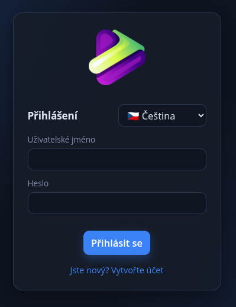
*Přihlašovací stránka — použijte ji po vytvoření účtu.*

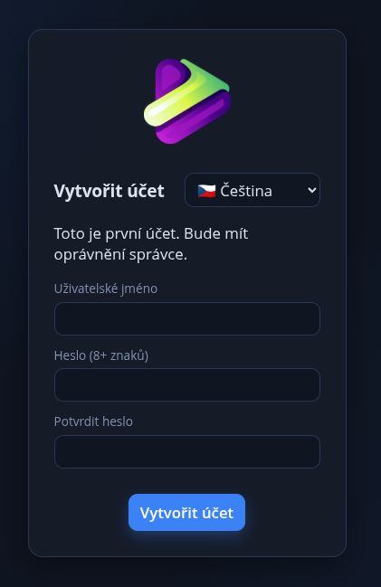
*Stránka pro vytvoření účtu. Pro úplně první účet pozvánkový kód není potřeba; každý další dostává od admina jednorázový kód.*

Poté na [profilové stránce](#113-profil--heslo-tokeny-pozvánky) vytvořte **tokeny zařízení** — každé zařízení by mělo mít vlastní token.

### 4.2 Zařízení

```sh
# Relay: místní webové rozhraní a API na :8085, sleduje rozhraní a znovu načítá srtla_send
sudo bun backend/client/client.ts --host 0.0.0.0

# Encoder: v rozhraní vyberte pipeline a SRT port relay
bun backend/client/client.ts --role encoder --pipelines /usr/share/belacoder/pipelines

# Combined
sudo bun backend/client/client.ts --role combined --pipelines /usr/share/belacoder/pipelines

# Relay: ihned při startu spustit i srtla_send
sudo bun backend/client/client.ts --start-srtla 6000 rec.example.com 5000
```

Otevřete `http://<device>:8085/`. **Čistě nové zařízení (ještě bez konfiguračního souboru) se otevře v průvodci nastavením** — projděte ho v [sekci 5](#5-průvodce-prvním-spuštěním). Připojení zařízení k ovládacímu serveru:

```sh
# na každém zařízení — token majitele tohoto zařízení
CONTROL_SERVER_TOKEN=tok-alice-1 bun backend/client/client.ts --role encoder --remote wss://ctl.example.com/device
```

> [!NOTE]
> Použijte proměnnou prostředí `CONTROL_SERVER_TOKEN`, nikoli `REMOTE_TOKEN` — klient čte právě tuto proměnnou. Při použití `sudo` přidejte přiřazení proměnné až za něj, aby se proměnná předala příkazu bez nutnosti nastavovat ji trvale v prostředí shellu.

### 4.3 Provozní (produkční) nasazení

#### systemd

Běhejte zkompilované binárky (`bun run build:client` / `bun run build:server`) jako službu. Příklad unit souboru zařízení (`/etc/systemd/system/irlctrl.service`):

```ini
[Unit]
Description=IRLCTRL device
After=network-online.target
Wants=network-online.target

[Service]
ExecStart=/usr/local/bin/bun /opt/irlctrl/client --config /var/lib/irlctrl/config.json
Restart=always
User=root

[Install]
WantedBy=multi-user.target
```

Ovládací server používá tentýž vzorec s `server` (root není potřeba). Role, URL/token ovládacího serveru a přepisy cest k binárkám dejte do konfiguračního souboru (`--config`) nebo do `EnvironmentFile` — zařízení si stav uchovává v cestě `--config`, která musí zůstat stálá, aby přežilo restart (a tedy autostart).

#### Docker

`docker-compose.yaml` spustí celou sestavu: ovládací server, relay, encoder a proxy pro OBS Studio:

```sh
docker compose up -d --build
```

- **server** — ovládací server (`Dockerfile`, image `majkl/irlctrl-control`), UI na `:8090`.
- **obs-client** — proxuje hostitelské OBS Studio (`ws://host.docker.internal:4455`) do serveru.
- **relay** — `client.ts --role relay`, bonduje SRT ven přes `srtla_send` (`Dockerfile.device`, image `majkl/irlctrl-device`).
- **encoder** — `client.ts --role encoder`, běží `ceracoder`/GStreamer a posílá SRT do relay; stejný device image, jiná role + `ENCODER_BIN`.

Kontejner **relay** potřebuje oprávnění `NET_ADMIN`, protože při startu nastavuje směrování podle jednotlivých uplinků (`ip rule add` a tabulky tras) a sleduje rozhraní pomocí `ip monitor`. Bez tohoto oprávnění vypíše `ip rule add … Operation not permitted` a skončí. Encoder je nepotřebuje. Ve výchozí síti bridge se změny směrování relayu projeví pouze v síťovém prostoru kontejneru. Má-li relay používat skutečná síťová rozhraní hostitele pro agregaci připojení, spusťte jej s `network_mode: host`.

#### Obraz Armbian (Orange Pi 5 Plus)

Adresář [`armbian/`](../armbian/) vytváří obraz Armbian připravený ke streamování. Obsahuje předinstalovaný celý řetězec pro streamování (GStreamer včetně zásuvných modulů Rockchip, CERALIVE SRT, ceracoder, srtla_send a pravidla udev), takže `client.ts --role combined` funguje ihned po spuštění zařízení.

---

## 5. Průvodce prvním spuštěním

Nové zařízení místo běžného rozhraní otevře **průvodce nastavením**. Každý krok se věnuje jednomu tématu. Pro roli *combined* je pořadí kroků **Jazyk → Role zařízení → Identita → Ovládací server → Kodér → Relay → Přehled**. Zařízení pouze s rolí encoder krok Relay vynechá; zařízení pouze s rolí relay vynechá krok Kodér.

**Tlačítko Uložit ověří nastavení, zapíše počáteční konfigurační soubor, připojí zařízení k ovládacímu serveru a spustí zvolenou roli.** Poté se zobrazí běžné rozhraní a průvodce se znovu nespustí.

### Krok 1 — Jazyk

Vyberte jazyk rozhraní (k dispozici je 12 jazyků). Lze ho kdykoli změnit v jazykovém výběru v hlavičce.

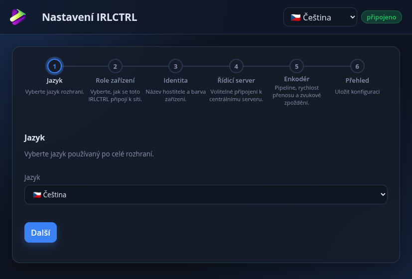

### Krok 2 — Role zařízení

Zvolte, jak se toto IRLCTRL zapojí do sítě. Tři možnosti přesně ukazují, co každá dělá:

- **Relay** — „Receives streams and forwards them with SRTLA“
- **Encoder** — „Captures a GStreamer pipeline and sends it over SRT“
- **Combined** — „Encodes and relays in a single service“

Výběrem možnosti *Combined* se do průvodce přidají kroky Kodér a Relay (celkem tedy sedm kroků, jak je vidět na snímku).

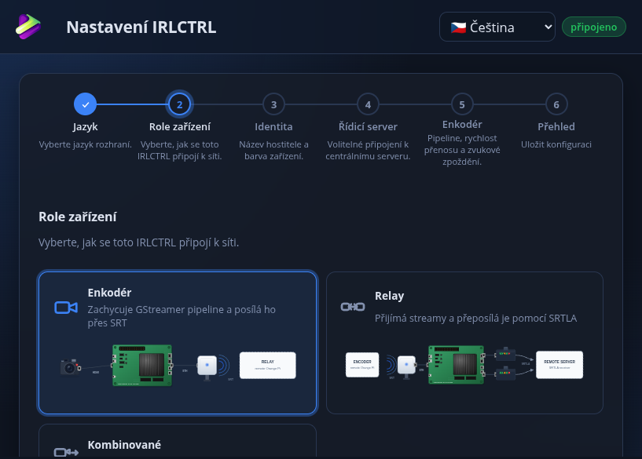

### Krok 3 — Identita

Jak se zařízení představuje ovládacímu serveru:

- **Jméno zařízení (hostname)** — malá písmena, číslice, tečky a pomlčky, max 64 znaků.
- **Akcentová barva** — barva hlavičky UI zařízení.

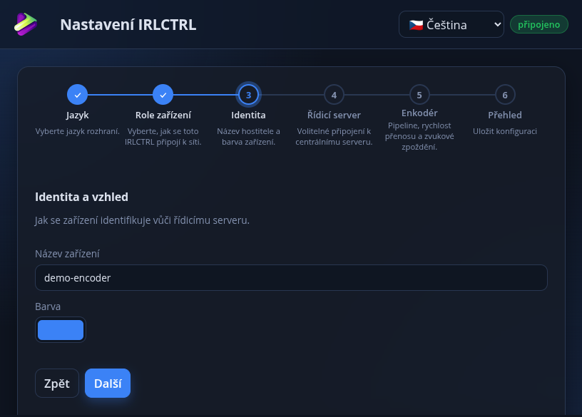

### Krok 4 — Ovládací server

Volitelné připojení k centrálnímu serveru:

- **URL ovládacího serveru** — např. `ws://192.168.1.10:8090/device` (nebo `wss://…` za TLS).
- **Ovládací token** — jeden z tokenů zařízení vytvořených na profilové stránce vlastníka. Chcete-li zařízení používat samostatně (pouze s místním rozhraním), ponechte obě pole prázdná.

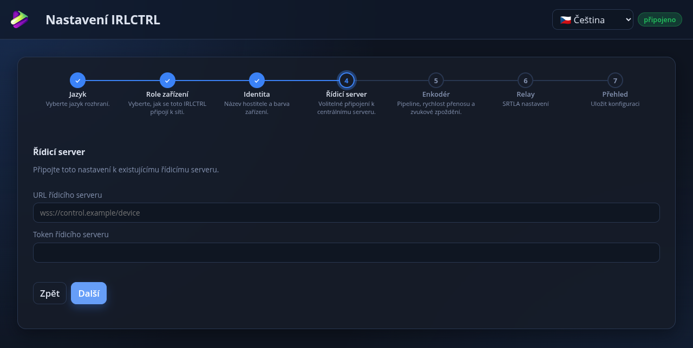

### Krok 5 — Enkodér

Pole pro enkodér a snímací pipeline:

- **Pipeline** — jeden ze souborů GStreamer pipeline v adresáři `--pipelines`, uspořádaných do podadresářů (např. `generic/h265_v4l_mjpeg_1080p`). Seznam se načte z disku; význam ostatních polí popisuje [Vysvětlení voleb enkodéru](#8-vysvětlení-voleb-enkodéru).
- **Min. / max. bitrate (kb/s)** — rozsah datového toku videa (výchozí hodnoty 300 a 5000).
- **Zdroj zvuku** — zvuková karta ALSA, ze které se bude snímat zvuk. Možnost „Pipeline default“ ponechá nastavení určené pipeline.
- **Zvukový kodek** — AAC nebo Opus.
- **Zpoždění zvuku (ms)** — posun zvukové stopy pro její synchronizaci s videem.
- **Zpoždění SRT (ms)** — přenosová latence SRT (výchozí hodnota 2000).
- **Stream ID** (volitelné) — SRT stream ID oznamovaný přijímači.
- **Bitrate overlay** — zobrazuje aktuální datový tok přímo ve videu.

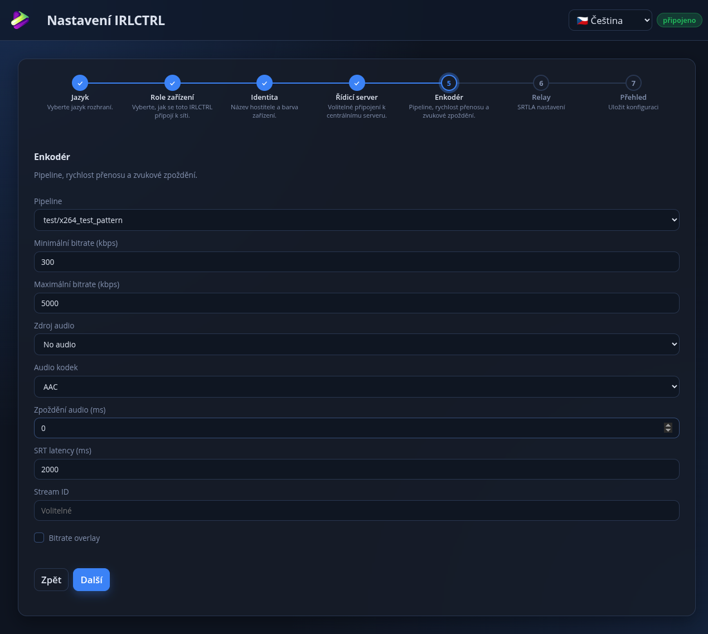

### Krok 6 — Relay

Pole SRTLA relay (jen pro role relay/combined):

- **SRT port naslouchání** — port, na který enkodér posílá SRT (výchozí 6000).
- **SRTLA vzdálený host / port** — cíl bondovaných uplinků, např. `rec.example.com:5000`.
- **Scheduler** — algoritmus plánování spojení `Enhanced` (výchozí) nebo `Classic`.
- **Hodnocení kvality** — SRTLA hodnocení používané pro výběr nejlepšího spojení.

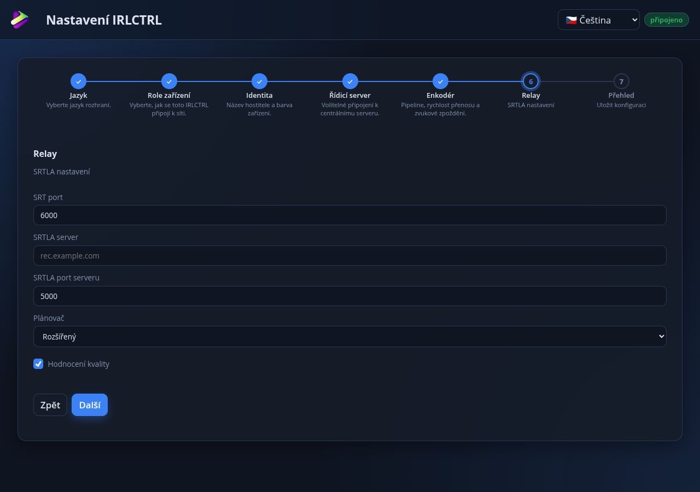

### Krok 7 — Přehled a uložení

Zkontrolujte všechna nastavení. Pomocí tlačítka Zpět se můžete kdykoli vrátit a něco změnit. Poté:

- **Autostart** — „Start the saved stream automatically after restart.“
- **Uložit konfiguraci** — uloží nastavení, připojí zařízení k ovládacímu serveru a spustí zvolenou roli.

Potvrzení zní: *„Configuration saved. Restart the service to apply the selected role, hostname and control server.“*

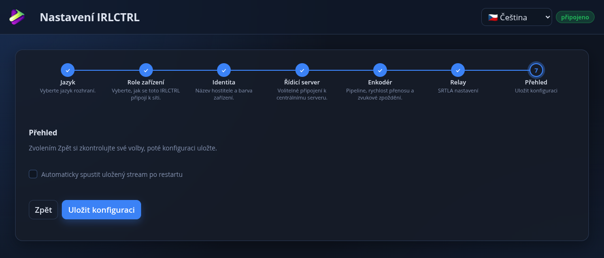

Po uložení se objeví běžné UI zařízení — [další sekce](#6-uživatelské-rozhraní-zařízení--běžná-obsluha).

---

## 6. Uživatelské rozhraní zařízení — běžná obsluha

Hlavní stránka (`http://<device>:8085/`) zobrazuje kartu pro každou funkci aktivní role. V hlavičce najdete **výběr jazyka**, **zaškrtávací políčko Autostart** („Set startup to autostart or manual“), **odznak role**, **stav připojení** k ovládacímu serveru a ozubené kolo **Device settings** (nastavení zařízení).

### 6.1 Kombinované zařízení (všechny karty)

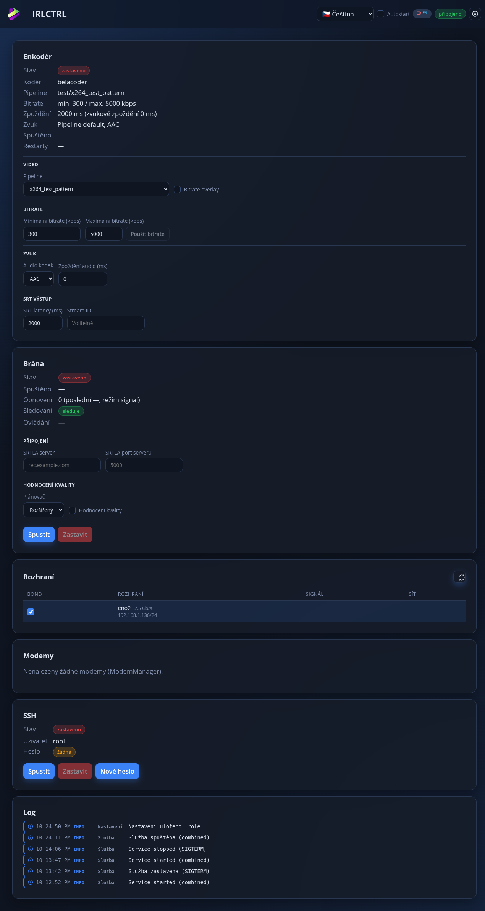
*Kombinované zařízení: karty Encoder, Relay, Interfaces, Modems, SSH a Log.*

### 6.2 Role encoder

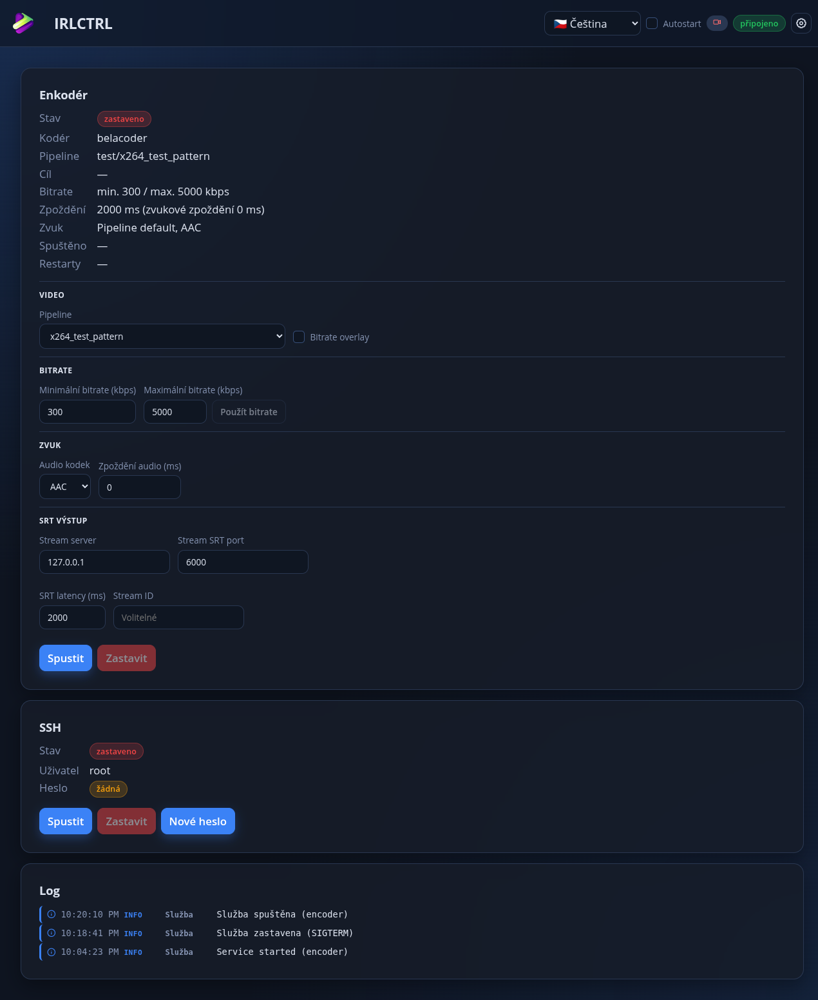
*Role encoder: karta Encoder se seznamem pipeline — bez karet Relay a Interfaces.*

### 6.3 Role relay

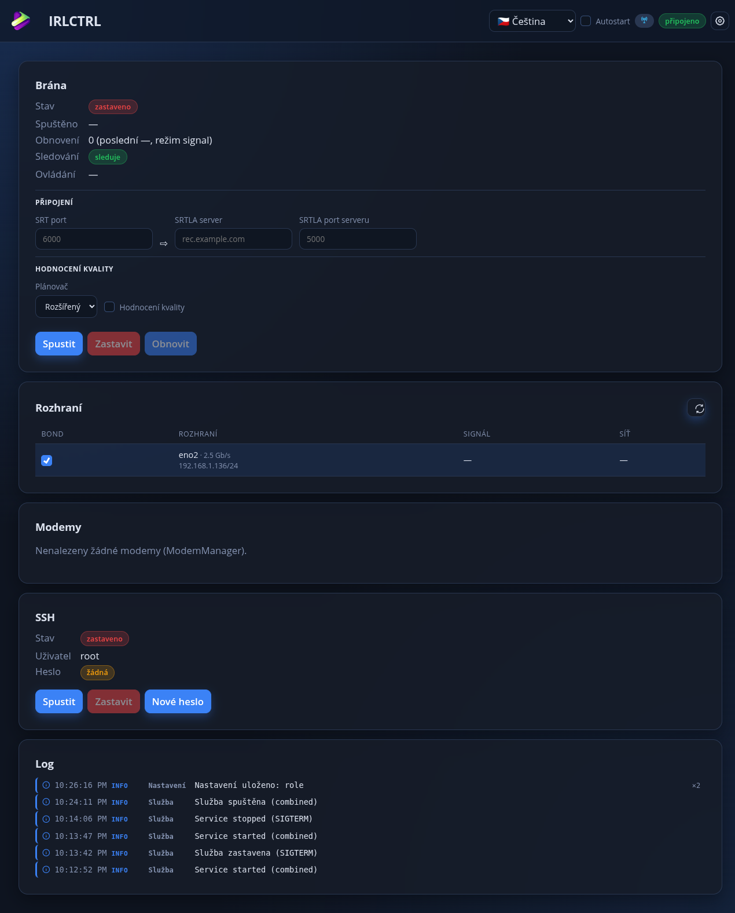
*Role relay: karty Relay (spojení a hodnocení kvality), Interfaces, Modems, SSH a Log.*

### 6.4 Karta Encoder

| Pole / skupina | Význam |
| --- | --- |
| **State** | `stopped`, `running`, `restarting`. |
| **Encoder** | Používaný program — `belacoder` nebo `ceracoder` (rozpoznává se automaticky podle názvu). |
| **Pipeline** | Aktuálně vybraná pipeline, např. `generic/h265_v4l_mjpeg_1080p`. Změní se v seznamu níže. |
| **Target** | (pouze samostatný encoder) Cílový SRT endpoint streamu: `host:port / stream ID`. |
| **Bitrate** | `min 300 / max 5000 kbps` — hodnoty lze upravit; **Apply bitrate** předá změnu běžícímu enkodéru (belacoder při signálu SIGHUP znovu načte soubor s nastavením datového toku). |
| **Latency** | `2000 ms (audio delay 0 ms)` — latence SRT a zpoždění zvuku. |
| **Audio** | Zdroj zvuku + kodek (`AAC`/`Opus`). |
| **Started / Restarts** | Doba běhu streamu a počet automatických restartů. |
| **Ceracoder bitrate control** | *pouze ceracoder* — regulátor datového toku: **Adaptive (RTT + buffer)**, **AIMD (TCP-style)** nebo **Fixed bitrate**, s nastavitelným krokem a intervalem zvyšování i snižování (kb/s, ms) a násobitelem při zahlcení (0–1). **Apply settings** změny použije bez restartu. |
| **Start / Stop** | Spustí/zastaví proces enkodéru. |

### 6.5 Karta Relay

| Pole / skupina | Význam |
| --- | --- |
| **State** | `stopped` / `running`; odznak `srtla_send down`, pokud proces zemřel. |
| **Started** | Kdy relay běží. |
| **Reloads** | `N (last <when>, mode <signal\|restart>)` — kolikrát se `srtla_send` reloadoval. |
| **Monitor** | `watching` — monitor rozhraní je aktivní. |
| **Quality scoring** | **Scheduler** `Enhanced`/`Classic` + zaškrtávací políčko **Quality scoring** — SRTLA hodnocení pro výběr nejlepšího spojení. |
| **Start / Stop / Reload** | Spuštění, zastavení nebo opětovné načtení procesu `srtla_send`; **Reload** znovu načte seznam uplinků (pomocí SIGHUP nebo úplným restartem podle `--srtla-reload`). |

### 6.6 Karta Interfaces

U každého síťového rozhraní se zobrazuje **zaškrtávací políčko Bond** („Include in bond“ — určuje, zda `srtla_send` bude rozhraní používat), **název rozhraní**, jeho rychlost (např. `eth0 · 10 Gb/s`) a adresa CIDR, **Signal** (u modemových rozhraní) a **Network** (tabulka směrování, do které je rozhraní přiřazeno). Tlačítko **Reconfigure** znovu použije změněné nastavení směrování.

### 6.7 Karta Modems

Zobrazuje všechny modemy spravované službou ModemManager: IMEI, operátora, stav registrace a sílu signálu. U každého lze použít akce **zapnout / vypnout / připojit / odpojit / resetovat**. Ve výběru zařízení pro agregaci na kartě Interfaces jsou modemy uvedeny jako `modem #N`. Pokud nejsou nalezeny žádné modemy, zobrazí se *„No modems found (ModemManager).“*

### 6.8 Karta SSH

Spravuje SSH server tohoto boxu: **State** (`stopped`/`running`), **User** (přihlašovací účet, výchozí `root`), **Password** (`none` / `configured`) a tlačítka **Start** / **Stop** / **New password** (heslo lze vygenerovat pouze při zastaveném SSH).

### 6.9 Karta Log

Trvalý protokol událostí zaznamenává všechny akce (změny konfigurace a datového toku, změny agregace spojení, spuštění a zastavení modulů i události modemů) včetně času a úrovně závažnosti. Zapisuje se do souboru `--log-file` a zachová se i po restartu.

### 6.10 Autostart (automatický start)

Zaškrtnutím **Autostart** v hlavičce (nebo zavoláním `autostart.set`) nastavíte automatické obnovení posledního streamu při každém spuštění služby. Pokud potřebné zařízení pro zachytávání, uplinky nebo přijímač ještě nejsou připravené, systém se o spuštění pokusí znovu každých 5 s. Ruční akce Start nebo Stop opakované pokusy zruší.

---

## 7. Stránka nastavení zařízení — všechny možnosti

Otevřete ozubené kolo v hlavičce zařízení a vyberte **Device settings**. Upozornění nahoře vysvětluje, jak se projeví uložení nastavení a změna role:

> *„Settings are re-applied on the control server after saving.“* a
> *„The new role takes effect after restarting the device service.“*

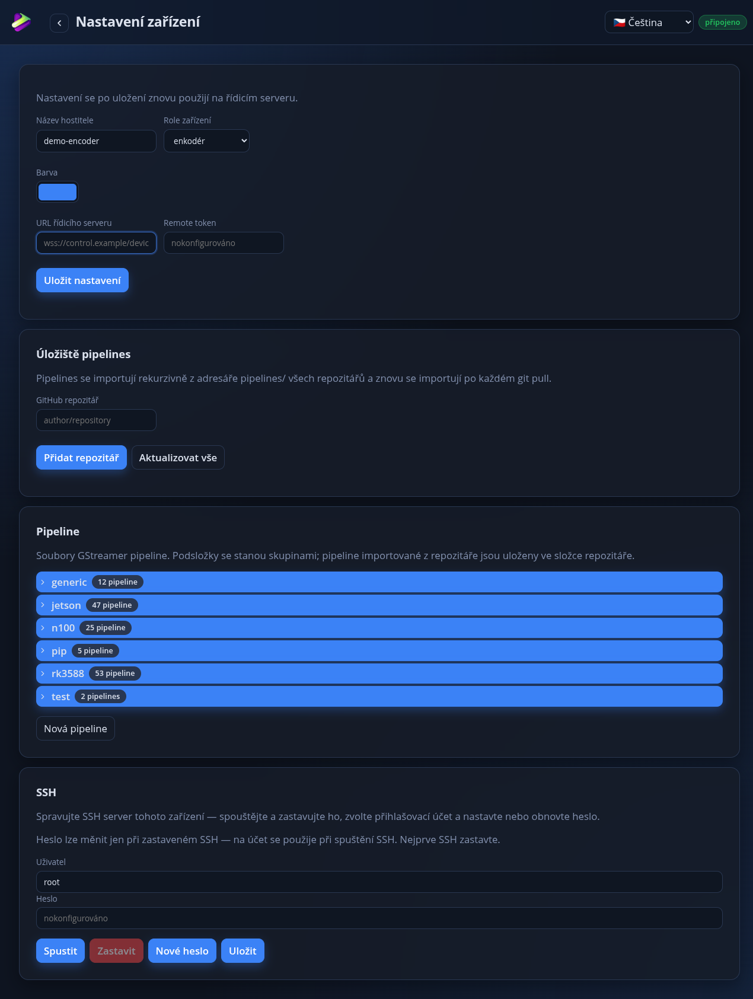

| Možnost | Význam |
| --- | --- |
| **Hostname** | Zobrazené jméno zařízení (malá písmena, číslice, tečky a pomlčky, max 64 znaků). UUID — pevná identita na ovládacím serveru — zůstává nezměněna a přežívá změny hostname. |
| **Device role** | `relay` / `encoder` / `encoder + relay (combined)` / `obs`. Změna role se projeví po restartu služby. |
| **Accent color** | Barva hlavičky UI zařízení. |
| **Control server URL** | Adresa ovládacího serveru ve tvaru `ws://…` nebo `wss://…` (`…/device`). Po uložení se zařízení znovu připojí a zaregistruje s novou adresou, tokenem, názvem hostitele a rolí, aniž by bylo nutné restartovat službu. |
| **Remote token** | Token zařízení jeho vlastníka. Zástupné texty: `configured (leave blank to keep)` / `not configured`. |
| **Save settings** | Uloží nastavení a znovu je uplatní na ovládacím serveru. |

### 7.1 Pipeline

Na zařízení jsou uloženy soubory GStreamer pipeline. **Podadresáře určují skupiny pipeline** (např. `generic/`, `jetson/`, `rk3588/`, `n100/`, `pip/`, `test/`); pipeline importované z repozitářů se ukládají do adresáře příslušného repozitáře. U každé skupiny se zobrazuje počet pipeline a akce **New pipeline / Edit / Delete**. Správce umožňuje soubory na disku zobrazovat, vytvářet, upravovat a mazat.

**Editor pipeline** (na adrese `/pipelines/new/` nebo po výběru *Edit* u existující pipeline):

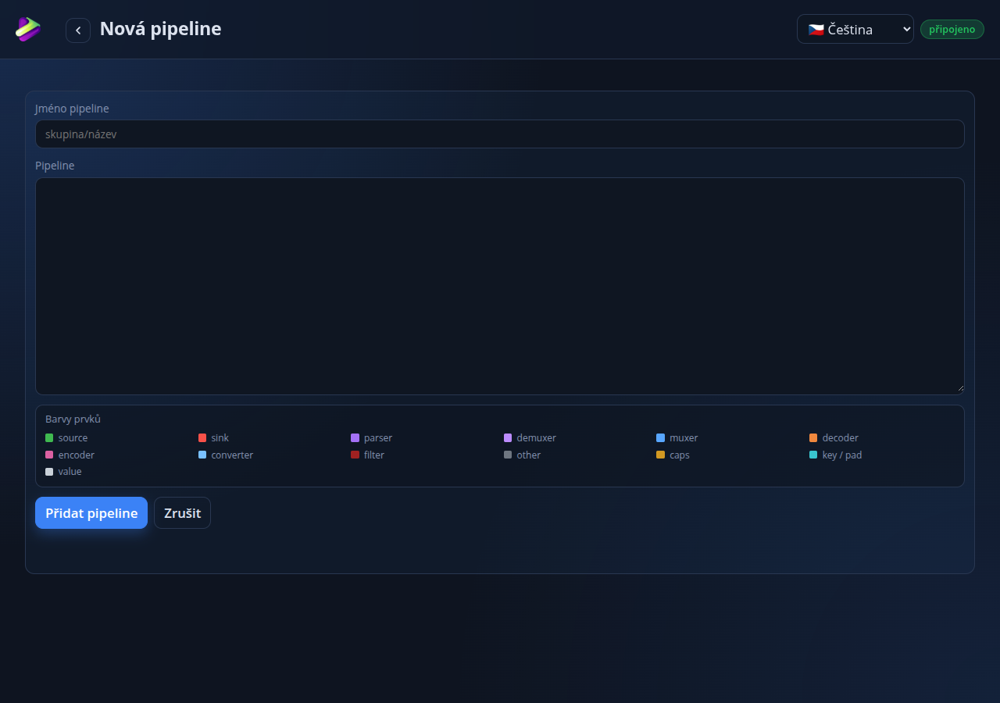

- **Cesta k pipeline** — cesta ve tvaru `group/name` (např. `test/x264_test_pattern`). Nový soubor se uloží na toto místo pod adresářem `--pipelines`.
- **Obsah pipeline** — příkazový řetězec GStreamer se zvýrazněnou syntaxí. Legenda **Element colours** označuje typy prvků: source, sink, parser, demuxer, muxer, decoder, encoder, converter, filter, other, caps, key-pad a value.
- **Save (Ctrl+S)** — soubor lze uložit pouze tehdy, obsahuje-li neprázdný příkazový řetězec GStreamer (alespoň jeden znak `!` mezi prvky).

> Každá pipeline musí odpovídat hardwaru a GStreamer pluginům dostupným na zařízení — např. Rockchip pipeline používají `mpph265enc`, který na běžném x86 hostu není k dispozici. Pokud UI oznámí *Pipeline is empty*, vyberte jinou pipeline nebo soubor obnovte.

### 7.2 Repozitáře pipeline

Pipeline lze importovat z GitHubu:

- **Add repository** — zadejte repozitář ve formátu `author/repository`. Soubory z jeho adresáře `pipeline/` se **rekurzivně importují** do `PIPELINES_DIR/author/repository/` a znovu se importují po každém stažení změn z Gitu.
- U každého repozitáře se zobrazuje odznak **počet pipeline** s akcemi:
  - **Update** — aktualizuje tento repozitář.
  - **Update all** — aktualizuje všechny nakonfigurované repozitáře a nahradí místní soubory; odstraní se tak i pipeline, které byly smazány v původním repozitáři.
  - **Remove** — odebere repozitář *i* jeho importované pipeline soubory.

### 7.3 OBS spojení

*Spojení s OBS Studio používané modulem obs-controller. Modul se po uložení restartuje.*

- **OBS WebSocket URL** — např. `ws://127.0.0.1:4455`.
- **OBS heslo** — heslo nastavené v OBS Studio (Settings → General/Stream). Ponechte prázdné pro zachování současného.

### 7.4 SSH

*Spravuje SSH server zařízení: umožňuje jej spustit či zastavit, vybrat přihlašovací účet a nastavit nebo změnit jeho heslo.*

- **User** — přihlašovací účet (výchozí `root`).
- **Start / Stop** — SSH server.
- **New password** — vygeneruje nové heslo; nová hodnota se zobrazí jen jednou. *Nové heslo lze vygenerovat pouze při zastaveném SSH — nejdřív SSH zastavte.*

---

## 8. Vysvětlení voleb enkodéru

Každá volba, kterou enkodér nabízí (krok průvodce, karta encoder, nastavení):

| Volba | Co znamená |
| --- | --- |
| **Pipeline** | Příkazový řetězec GStreamer, který spustí belacoder nebo ceracoder. Identifikátory pipeline odpovídají cestám pod `--pipelines`, např. `rk3588/h265_hdmi_1440p25`. Před spuštěním se pipeline upraví stejně jako v belaUI (výběr zvukové karty, přepnutí AAC na Opus apod.). |
| **Min bitrate (kbps)** | Dolní mez rozsahu datového toku videa. |
| **Max bitrate (kbps)** | Horní mez rozsahu datového toku videa. U **belacoder** se změna zapíše do souboru a po signálu SIGHUP se znovu načte, takže není nutné program restartovat. |
| **Zdroj zvuku** | Zvuková karta ALSA, ze které se snímá zvuk. `Pipeline default` ponechá nastavení určené pipeline; výběr konkrétní karty změní příslušný prvek zvukového zdroje. |
| **Zvukový kodek** | `AAC` nebo `Opus` — kodek zvukové stopy v odchozím streamu SRT. |
| **Zpoždění zvuku (ms)** | Časový posun zvukové stopy pro její synchronizaci s videem. |
| **SRT zpoždění (ms)** | Latence přenosu SRT mezi enkodérem a relay (výchozí hodnota 2000 ms). |
| **Stream ID** (volitelné) | Identifikátor streamu SRT předávaný přijímači. Pro stream bez identifikátoru pole ponechte prázdné. |
| **Bitrate overlay** | Zobrazuje aktuální datový tok přímo ve videu. |
| **Stream host / SRT port / Stream ID** (jen samostatný encoder) | Cílový SRT endpoint relay, na který encoder stream odesílá. |
| **Bitrate balancer** (jen ceracoder) | `Adaptive (RTT + buffer)` upravuje datový tok podle RTT a vytížení vyrovnávací paměti; `AIMD (TCP-style)` jej zvyšuje po krocích a při zahlcení násobně snižuje, podobně jako řízení zahlcení TCP; `Fixed bitrate` nastaví konstantní datový tok. |
| **Krok zvýšení (kbps) / Interval zvýšení (ms)** (ceracoder) | O kolik a jak často může regulátor datový tok zvýšit. |
| **Krok snížení (kbps) / Interval snížení (ms)** (ceracoder) | O kolik a jak často může regulátor datový tok snížit. |
| **Násobitel při zahlcení (0–1)** (ceracoder) | Určuje, jak výrazně se při zahlcení sníží datový tok (1 = výrazné snížení, 0 = beze změny). |

---

## 9. Vysvětlení voleb relay / SRTLA

| Volba | Co znamená |
| --- | --- |
| **SRT port naslouchání** | Port, na kterém relay přijímá stream SRT z enkodéru (výchozí hodnota 6000). |
| **SRTLA vzdálený host** | Cílový server SRTLA, zadaný názvem hostitele nebo IP adresou. |
| **SRTLA vzdálený port** | Port SRTLA přijímače (výchozí hodnota 5000). |
| **Scheduler** | `Enhanced` (výchozí) používá vylepšený algoritmus rozdělování dat mezi spojení; `Classic` používá původní algoritmus. Změna se použije ihned přes řídicí socket. |
| **Hodnocení kvality** | Zapne hodnocení spojení pro výběr nejvhodnější trasy SRTLA. Zohledňuje podíl na celkové propustnosti, minimální RTT a ukazatele kvality (`up`, `weak`, `stalled`, `timed out`); plánovač pak podle výsledného skóre rozděluje data mezi spojení. |
| **Bond (podle rozhraní)** | Určuje, která rozhraní se zapojí do agregace spojení. Při startu relay nastaví směrování pro jednotlivé uplinky (`ip rule` a tabulky tras), aby každý uplink používal určené rozhraní. Tlačítko **Reconfigure** nastavení znovu použije. |
| **Reload režim** | Určuje postup po změně nastavení přes `--srtla-reload` nebo tlačítko Reload: `signal` odešle SIGHUP a znovu načte soubor uplinků; `restart` celý proces restartuje. |
| **Uplinks soubor** | Soubor zadaný přepínačem `--uplinks`, který používá `srtla_send` (jedna IP adresa pro každý zahrnutý uplink). |
| **Kontrolní socket** | `--srtla-socket` umožňuje získávat aktuální statistiky spojení a měnit režim či hodnocení kvality. Hodnota `""` jej vypne. |
| **Start / Stop / Reload** | Spouští, zastavuje nebo znovu načítá proces `srtla_send`. V roli *combined* ovládá jedno tlačítko Start/Stop enkodér i relay. |

> [!IMPORTANT]
> Relay potřebuje oprávnění uživatele root (v Dockeru oprávnění `NET_ADMIN`), aby mohl nastavit směrovací pravidla. Bez nich vypíše `ip rule add … Operation not permitted` a skončí.

---

## 10. Modul OBS Studio & přepínač nízkého bitrate

Modul **obs-controller** vlastní spojení [obs-websocket](https://github.com/obsproject/obsproject/obs-websocket) (v5) na spárovanou instanci OBS Studio a předává její události do událostního proudu zařízení. Nastavuje se v **Settings → OBS connection** (URL + heslo; modul se po uložení restartuje). Jeho konfigurační formulář nabízí:

| Volba | Význam |
| --- | --- |
| **OBS WebSocket URL** / **Password** | Adresa a heslo pro připojení k OBS Studio. Ponecháte-li heslo prázdné, uložené heslo se nezmění. |
| **Subscribe to scene events** | Předávat také události změny scény (používají je dashboardy a přepínač). |

Karta OBS Studio zobrazuje **Current scene**, **Scene list** (s ovládáním přepínání scén), stavy **Streaming**, **Recording** a **Studio mode**, sekci **Output** (stav mikrofonu a ovládání ztlumení), **Audio level** a tlačítka **Start/Stop stream**, **Start/Stop recording**, **Screenshot** a **Refresh**.

### 10.1 Přepínač nízkého bitrate

Stavový automat sleduje metriky SRT a OBS a při zhoršení připojení automaticky přepíná OBS mezi scénami **normal / low / offline**:

| Skupina | Volba | Význam |
| --- | --- | --- |
| — | **Low-bitrate switcher** (zaškrtávací políčko) | Zapíná nebo vypíná přepínač. *No engine running yet. Set the OBS SRT source above, pick the scenes, and save — the switcher starts once its config is stored.* |
| — | **OBS SRT source** | Název SRT zdroje v OBS, jehož statistiky přepínač sleduje. Pokud statistiky nejsou dostupné, zobrazí se upozornění *No SRT stats from OBS…* |
| Spouštěče | **Low bitrate (kbps)** | Při poklesu datového toku SRT pod tuto hodnotu se přepne na scénu s nízkým datovým tokem. |
| Spouštěče | **Offline bitrate (kbps)** | Při poklesu pod tuto hodnotu se spojení považuje za přerušené a zobrazí se offline scéna. |
| Spouštěče | **RTT (ms)** | Hodnota RTT vyšší než nastavený limit se považuje za zhoršení spojení. |
| Spouštěče | **Retry attempts** | Počet neúspěšných měření, po kterém se zhoršení potvrdí. |
| Spouštěče | **Poll interval (ms)** | Interval načítání statistik SRT. |
| Spouštěče | **Automatic switching** | Povoluje automatické přepínání scén. |
| Spouštěče | **Switch back instantly on recovery** | Při zlepšení kvality okamžitě přepne zpět na běžnou scénu, bez čekání na uplynutí hysterezního intervalu. |
| Spouštěče | **Only switch while streaming** | Omezuje přepínání scén na dobu, kdy probíhá streamování. |
| Spouštěče | **Write log to file** | Zapisuje rozhodnutí přepínače do souboru protokolu. |
| Scény | **Normal** | Scéna používaná při běžné kvalitě spojení. |
| Scény | **Low bitrate** | Scéna používaná při snížené kvalitě spojení. |
| Scény | **Offline** | Scéna používaná při přerušení spojení. |
| Scény | **Starting (volitelné)** / **Ending (volitelné)** | Scény zobrazené při zahájení nebo ukončení přechodu. |
| Scény | **Privacy (volitelné)** | Scéna zobrazovaná po dobu výpadku (např. „Za chvíli jsme zpět“). |

Stavová tabulka zobrazuje stav přepínače pro každé spojení: **State** (`normal` / `low bitrate` / `offline` / `idle`), **SRT bitrate**, **SRT RTT**, **Desired** (požadovaná scéna), **Program scene**, počet **retry** a **Last update**.

---

## 11. Obsluha ovládacího serveru

Spusťte server příkazem `bun backend/server/server.ts --port 8090`, přihlaste se a můžete spravovat připojená zařízení.

### 11.1 Seznam zařízení

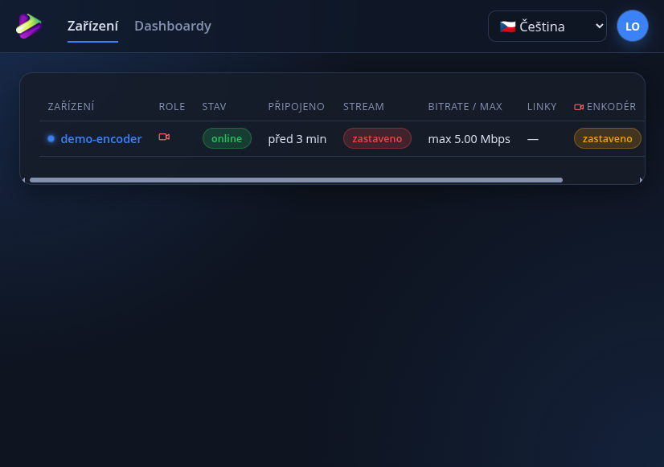

Tabulka zobrazuje všechna zařízení patřící přihlášenému uživateli:

| Sloupec | Význam |
| --- | --- |
| **Device** | Hostname + UUID. |
| **Role** | `relay` / `encoder` / `encoder + relay` / `obs` (odznaky). |
| **Status** | `online` / `offline` (včetně času *last seen*); `stale` označuje zařízení, od kterého server přestal dostávat stavové zprávy. |
| **Connected** | Informace o aktivním spojení WebSocket se zařízením. |
| **Stream** | Odznak `streaming` / `stopped` / `no links`. |
| **Bitrate / max** | Aktuální datový tok v porovnání s nastaveným maximem. |
| **Links** | Agregovaná síťová spojení: podíl na celkové propustnosti, minimální RTT a stav kvality (`up` / `weak` / `stalled` / `timed out` / `sole carrier`) každého spojení. |
| **Encoder / Relay** | Stavový štítek pro každou část zařízení. |

Kliknutím na zařízení se otevře jeho **stránka zařízení**.

### 11.2 Stránka zařízení (`/d/<id>/`)

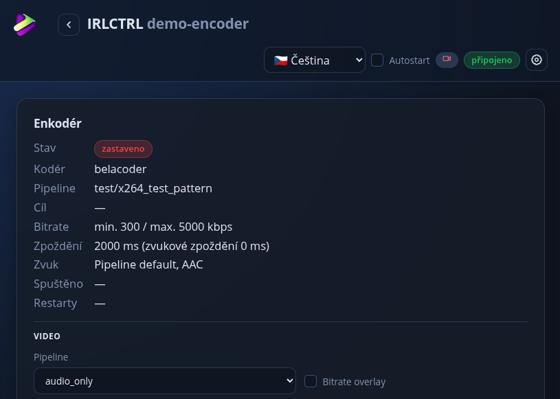

Stránka zařízení zobrazuje **stejné karty** jako místní rozhraní zařízení (Encoder, Relay, Interfaces, Modems, SSH a Log). Je poskytována ovládacím serverem, který příkazy předává zařízení přes jeho odchozí spojení — můžete tak ovládat i zařízení za NAT nebo v mobilní síti. V hlavičce je navíc zaškrtávací políčko **Autostart** a odkaz **Device settings**. Akce Start, Stop, Reload a nastavení fungují stejně jako v [sekci 6](#6-uživatelské-rozhraní-zařízení--běžná-obsluha).

### 11.3 Profil — heslo, tokeny, pozvánky

Dostanete se k ní z menu uživatelského jména v hlavičce.

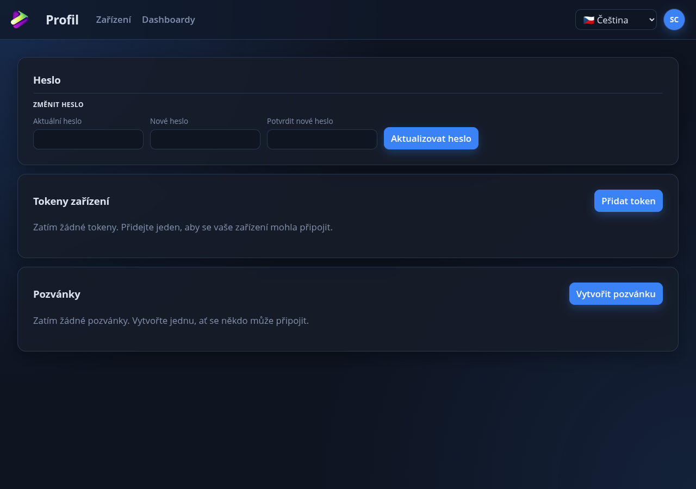

- **Change password** — aktuální heslo, nové heslo (alespoň 8 znaků) a jeho potvrzení.
- **Device tokens** — **Add token** vydá nový token; **kliknutím zkopírujete** hodnotu; **Remove** jej odvolá. *„No tokens yet. Add one so your devices can connect.“* Každé zařízení, které chcete spravovat, by se mělo připojit s jedním z vašich tokenů (`--remote-token` / `CONTROL_SERVER_TOKEN`).
- **Invitations** (pouze pro administrátory) — **Create invitation** vytvoří jednorázový kód, případně s nastavenou platností. Nový uživatel jej zadá na [registrační stránce](screenshots/02-register-cs.png). *„No invitations yet. Create one so someone can join.“*

### 11.4 Dashboardy

Dashboardy jsou pro každého uživatele uloženy v databázi SQLite a průběžně se aktualizují. Společný datový proud odesílá data widgetů do všech právě otevřených zobrazení.

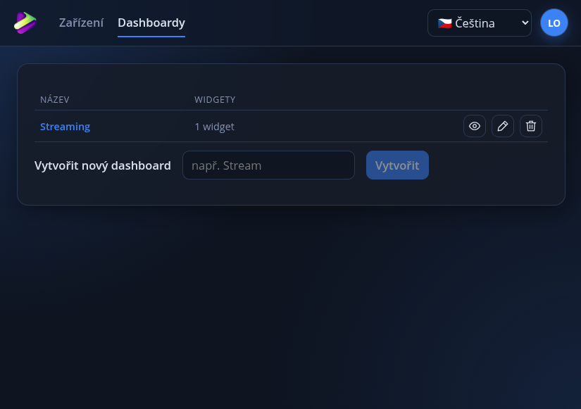

- **Vytvořit nový dashboard** — zadejte název (např. *Streaming*) a stiskněte **Create**.
- Každý řádek obsahuje **Name** (odkaz na stránku dashboardu), počet **Widgets** a akce **View / Edit / Delete**.

**Přidat widget** — vyberte typ:

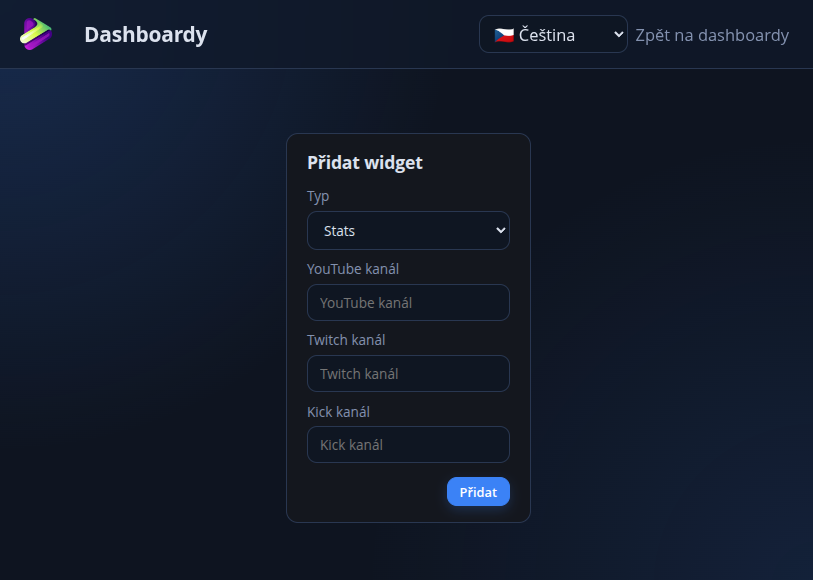

Widgety jsou dvou druhů:

- **Widgety zařízení** — živá stavová karta pro zařízení s rolí `relay`, `encoder`, `combined` nebo `obs`, podle jeho role a aktivních modulů. Seznam typů obsahuje jednu položku pro každé připojené zařízení (např. *Combined*).
- **Kanálové widgety** — nejsou vázané na konkrétní zařízení: **Stats** (počet diváků na YouTube, Twitchi nebo Kicku) a **Chat** (sloučené chatové kanály).

**Pohledová stránka dashboardu:**

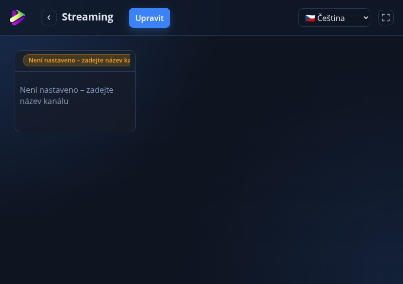

**Možnosti v režimu úprav a zobrazení:**

| Možnost | Význam |
| --- | --- |
| **Rename** | Pole pro úpravu názvu v hlavičce editačního režimu. |
| **+ Add widget / Remove (×)** | Přidat nebo odebrat widgety. |
| **⠿ drag handle** | Přesunutí widgetů v mřížce a změna jejich pořadí. |
| **Width: third / half / full** | Šířka widgetu v mřížce (4 / 6 / 12 sloupců). |
| **Move up / Move down** | Přesunout widget svisle nahoru/dolů. |
| **New messages: On top / At the bottom** | Určuje, zda se nové zprávy chatu zobrazují nahoře, nebo dole. |
| **History lines** | Počet řádků historie chatu, které se uchovávají. |
| **Channel settings** (chatové a statistické widgety) | **YouTube channel** (ID nebo uživatelský název kanálu), **Twitch channel** a **Kick channel** se nastavují samostatně. Statistiky se každých 30 s načítají z jednotlivých zdrojů a zobrazují počet diváků i součet za poslední hodinu. Do vyplnění názvu se zobrazuje *„Not configured – set a channel name“*. K dispozici jsou také **TikTok channel** a samostatná varianta **Kick (independent)**. |
| **Enter fullscreen / Exit fullscreen** | Přepnutí celého dashboardu do režimu celé obrazovky nebo zpět. |
| **Done** | Ukončí úpravy a vrátí dashboard do běžného zobrazení. |
| **Hide** | Skryje obsah widgetu. |

Widget zařízení, na kterém je modul vypnutý, zobrazuje *Module disabled on device*. Pokud zařízení již není dostupné, widget zobrazí *No device*.

---

## 12. Reference příkazové řádky

### 12.1 Klient zařízení (`backend/client/client.ts`)

| Volba | Proměnná | Výchozí | Co dělá |
| --- | --- | --- | --- |
| `--role` | `ROLE` | `relay` | `relay`, `encoder` nebo `combined`. |
| `--host`, `--port` | — | `127.0.0.1`, `8085` | Lokální web UI a WebSocket API (`/ws`), vždy zapnuto. |
| `--allow-origin` | — | — | Další povolené zdroje požadavků prohlížeče pro `/ws` (oddělené čárkami, `*` = libovolný zdroj). |
| `--config` | — | `$TMPDIR/config.json` | Konfigurační soubor zařízení: nastavení, enkodér, cíl SRTLA, automatické spuštění a modemy. **V produkci použijte trvalou cestu**, protože ji automatické spuštění potřebuje i po restartu. |
| `--uplinks` | — | `$TMPDIR/srtla_ips.txt` | Soubor se seznamem uplinků pro `srtla_send`. |
| `--start-srtla` | — | — | Pro role relay a combined spustí při startu `srtla_send` s parametry `<listenPort> <remoteHost> <remotePort>`. |
| `--srtla-reload` | — | `signal` | Určuje, jak znovu načíst `srtla_send`: pomocí signálu `SIGHUP` (`signal`) nebo restartováním procesu (`restart`). |
| `--srtla-socket` | `SRTLA_CONTROL_SOCKET` | `$TMPDIR/srtla_send.sock` | Řídicí socket `srtla_send` (statistiky spojení, režim a kvalita); hodnotou `""` jej vypnete. |
| `--debounce-ms` | — | `1500` | Doba odložení zpracování událostí síťového rozhraní v milisekundách. |
| `--pipelines` | `PIPELINES_DIR` | `/usr/share/belacoder/pipelines` | Adresář se soubory pipeline včetně podadresářů. |
| `--encoder` | `ENCODER_BIN` | `belacoder` | Cesta k programu enkodéru. `ceracoder` se rozpozná podle názvu a modul enkodéru se přepne do režimu konfigurace INI. |
| — | `SRTLA_SEND_BIN` | `srtla_send` | Cesta k binárce `srtla_send`. |
| `--bitrate-file` | — | `$TMPDIR/belacoder_br` | Soubor bitrate pro belacoder (při SIGHUP se znovu načte). |
| `--ceracoder-conf` | — | `$TMPDIR/ceracoder.conf` | Konfigurační soubor INI pro ceracoder (regulátor datového toku a další nastavení); změny modul enkodéru použije za běhu. |
| `--log-file` | — | `$TMPDIR/srtla_log.json` | Soubor pro trvalý protokol událostí zobrazovaný ve webovém rozhraní. |
| `--remote` | `CONTROL_SERVER_URL` | — | Adresa ovládacího serveru, např. `wss://ctl.example.com/device`. Proměnná prostředí přepíše hodnotu v konfiguračním souboru; argument příkazového řádku přepíše obě. |
| `--remote-token` | `CONTROL_SERVER_TOKEN` | — | Token zařízení. **Přednostně použijte proměnnou prostředí**, aby se token neobjevil ve výpisu procesů (`ps`). Proměnná prostředí přepíše hodnotu v konfiguračním souboru. |
| `--remote-interval` | — | `30` | Interval odesílání stavu na server v sekundách (`0` = pouze při změně). |
| `--remote-stats-interval` | — | `2` | Interval odesílání statistik spojení `srtla_send` v sekundách. |
| `--dry-run` | — | — | Vypíše příkazy `ip` a akce s procesy, ale neprovede je (bezpečné testování). |

### 12.2 Ovládací server (`backend/server/server.ts`)

| Volba | Proměnná | Výchozí | Co dělá |
| --- | --- | --- | --- |
| `--host`, `--port` | — | `0.0.0.0:8090` | Adresa, na které server naslouchá. V produkci jej provozujte za reverzní proxy s TLS (tokeny zařízení a relační cookie vyžadují `wss://` a `https://`). |
| `--db` | `SRTLA_DB` | `users.db` | Databáze SQLite obsahující uživatele, tokeny zařízení a dashboardy. |
| `--no-auth` | — | — | Pouze pro místní testování: používá se společný profil `local` bez tokenů a databáze; dashboardy se uchovávají pouze v paměti. |

### 12.3 OBS klient (`backend/obs-client/obs-client.ts`)

```
Usage: bun backend/obs-client/obs-client.ts --remote ws://host:port/device
    [--obs ws://127.0.0.1:4455] [--obs-password pw]
    [--remote-token pw] [--hostname name]
    [--config path] [--uuid uuid]
```

| Volba | Význam |
| --- | --- |
| `--remote` | Koncový bod `/device` ovládacího serveru (povinné). |
| `--remote-token` | Token zařízení jeho vlastníka. |
| `--obs` | OBS Studio WebSocket hosta (výchozí `ws://127.0.0.1:4455`). |
| `--obs-password` | Heslo OBS Studio. |
| `--hostname` | Jméno zařízení zobrazované na ovládacím serveru. |
| `--config` | Konfigurační soubor (uchovává UUID a nastavení). |
| `--uuid` | Explicitní pevná identita zařízení. |
| `--remote-interval` | Interval push stavu v sekundách (výchozí 30). |

Klient implementuje úplný handshake obs-websocket v5 (`Hello` → `Identify` → `Identified`), beze změn předává požadavky `Request` a `RequestBatch` ze serveru a publikuje události OBS jako zprávy `obs.event`. Dashboardy tak mohou reagovat na změny scény, streamu nebo nahrávání. Při výpadku se klient automaticky znovu připojuje s exponenciálně se prodlužující prodlevou; při odpojení vyšle syntetickou událost *ObsDisconnected* a po opětovném připojení odešle aktuální stav.

---

## 13. Řešení problémů

| Příznak | Co zkontrolovat |
| --- | --- |
| **Průvodce nepokračuje** | Kontrola vstupů nehlásí chybu přímo — některé povinné pole může být prázdné nebo neplatné (formát názvu hostitele, chybějící pipeline či port). Vyplňte všechna pole; u výběrových polí nahraďte výchozí zástupnou možnost platnou hodnotou. |
| **„Pipeline is empty“** | Vybraný soubor pipeline je prázdný nebo obsahuje pouze bílé znaky. Vyberte jinou pipeline na kartě Encoder nebo soubor obnovte či vytvořte v **Settings → Pipelines**. |
| **Pipeline se nespustí** | Pipeline nemusí odpovídat hardwaru (např. `mpph265enc` na x86) nebo mohou chybět zásuvné moduly GStreamer. Vyberte pipeline ze skupiny určené pro váš hardware. |
| **Relay skončí: `ip rule add … Operation not permitted`** | Chybí oprávnění root nebo `NET_ADMIN`. Spusťte službu jako root (systemd) nebo přidejte příslušné oprávnění v Dockeru. |
| **Odznak `srtla_send down`** | Proces `srtla_send` skončil. Zkontrolujte kartu Log, opravte cílovou adresu SRTLA přijímače a stiskněte Start (nebo Reload). |
| **Encoder se stále zobrazuje jako `restarting`** | Zkontrolujte počet restartů a kartu Log. Příčinou bývá nedostupné snímací zařízení nebo chyba pipeline. |
| **Zařízení je na ovládacím serveru `offline`** | Zařízení neběží nebo má nesprávnou adresu či token. U poslední stavové zprávy je uveden čas *last seen*. Zkontrolujte `--remote` a `--remote-token` (nebo **Settings → Control server URL / Remote token**). |
| **Stav „stale, …“** | Zařízení je připojené, ale neodesílá stavové zprávy. Příčinou může být problém se sítí mezi zařízením a serverem nebo příliš dlouhý interval `--remote-interval` či `--remote-stats-interval`. |
| **V přepínači chybějí statistiky SRT** | V OBS není načten obs-websocket v5 nebo název zdroje *OBS SRT source* neodpovídá názvu SRT vstupu v OBS. |
| **Nelze nastavit nové SSH heslo** | Nejdřív SSH zastavte — nové heslo lze vygenerovat pouze při zastaveném SSH. |
| **Registrace selhává kvůli pozvánce** | Chyby *inviteInvalid*, *inviteUsed* nebo *inviteExpired* znamenají, že je kód neplatný, použitý nebo vypršel. Požádejte administrátora o nový kód; pouze první účet lze vytvořit bez pozvánky. |
| **Nastavení zařízení je uloženo, ale role se nezměnila** | Jde o očekávané chování: *„The new role takes effect after restarting the device service.“* Pro použití nové role restartujte službu zařízení. |
| **Relay v Dockeru neagreguje uplinky hostitele** | V síti bridge se změny směrování projeví pouze v síťovém prostoru kontejneru. Spusťte relay s `network_mode: host`. |

### Běžné události protokolu (karta Log)

Protokol zaznamenává například změny konfigurace, `Bitrate set to min X / max Y kbps`, `Bond toggle` (`eth0 toggled in bond` / `Bond selection updated`), `Mode set to enhanced|classic`, zapnutí, vypnutí či nastavení modulů, připojení, odpojení a reset modemů i vytvoření, aktualizaci a odstranění pipeline. Každá událost má časové razítko a úroveň závažnosti a ukládá se do souboru `--log-file`.

---

*Další informace: [README](../README.md) popisuje architekturu a vývoj, [modules/README.md](../modules/README.md) systém modulů a katalogy překladů pro 12 podporovaných jazyků najdete v adresáři `i18n/`.*
