# IRLCTRL — User Operations Manual

This manual explains how to **turn on**, **operate**, and **configure** IRLCTRL — a Bun-based controller for [BELABOX](https://belabox.net/)-style bonded streaming. One program covers three device types, and an optional control server manages a whole fleet of them from a browser.

All screenshots in this manual were captured from a real running instance and are in [`docs/screenshots/`](screenshots/).

---

## Table of contents

1. [Overview](#1-overview)
2. [Roles](#2-roles)
3. [Requirements](#3-requirements)
4. [Turning the software on](#4-turning-the-software-on)
5. [First-run setup wizard](#5-first-run-setup-wizard)
6. [The device UI — daily operation](#6-the-device-ui--daily-operation)
7. [Device settings page — every option](#7-device-settings-page--every-option)
8. [Encoder options explained](#8-encoder-options-explained)
9. [Relay / SRTLA options explained](#9-relay--srtla-options-explained)
10. [OBS Studio module & low-bitrate switcher](#10-obs-studio-module--low-bitrate-switcher)
11. [Control server operation](#11-control-server-operation)
12. [Command-line reference](#12-command-line-reference)
13. [Troubleshooting](#13-troubleshooting)

---

## 1. Overview

IRLCTRL captures a livestream on an **encoder** box and bonds it out over several network uplinks (multiple modems / Wi-Fi / Ethernet) with [`srtla_send`](https://github.com/irlserver/srtla_send) so that no single weak link can kill the stream. An optional **control server** ties everything together in a browser.

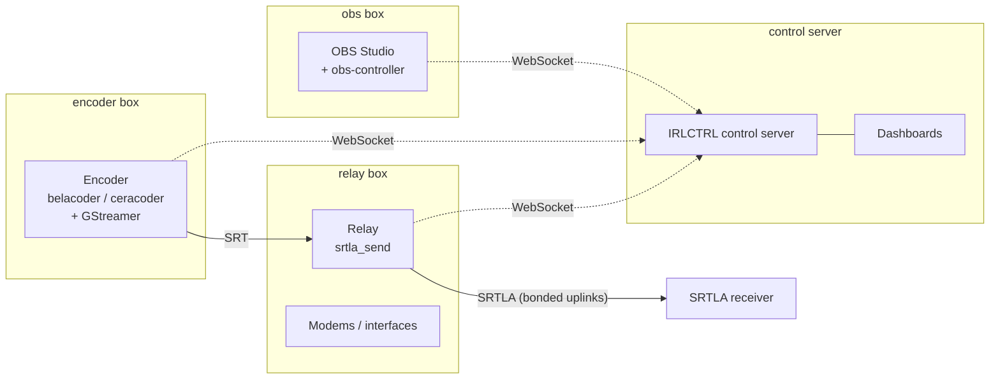

The simplest deployment is the **combined** role: encoder and relay live in one box, the stream goes from the encoder straight into a local `srtla_send`, and a single Start/Stop button drives both.

Typical topology:

```
encoder ──SRT──▶ relay ──SRTLA (bonded)──▶ SRTLA receiver
combined ─────────SRTLA (bonded)─────────▶ SRTLA receiver
        ▲                ▲
        └── control server (optional, WebSocket) ──┘
```

### Main parts of the program

| Part | Entry point | What it is |
| --- | --- | --- |
| **Device client** | `backend/client/client.ts` | Runs on each encoder/relay/combined box. Serves the local web UI + API on port **8085**, watches interfaces, runs the encoder and/or `srtla_send`, talks modems, and (optionally) dials the control server. |
| **Control server** | `backend/server/server.ts` | Central management server on port **8090**: user accounts, device list, per-user dashboards. Reaches devices over their *outbound* WebSocket, so devices behind NAT / mobile networks are fully manageable. |
| **OBS client** | `backend/obs-client/obs-client.ts` | Standalone "obs" role device for machines that run OBS Studio separately. Proxies the host's OBS Studio into the control server so dashboards can show and control OBS. |

---

## 2. Roles

### Device roles

One binary, four roles — the role is chosen with the `--role` flag (or in the first-run wizard / settings page). **The UI only shows what applies to the active role.**

| Role | Default? | What it does | Needs root? |
| --- | --- | --- | --- |
| `relay` | **yes** | Receives SRT from an encoder and bonds it out over all uplinks with `srtla_send`. Manages source routing, the uplinks file, and modems (ModemManager). | yes (bonding / routing) |
| `encoder` | no | Runs [belacoder](https://github.com/BELABOX/belacoder) or [ceracoder](https://github.com/CERALIVE/ceracoder) with a GStreamer pipeline and sends SRT to a relay. No routing, no modems, no `srtla_send`. | no |
| `combined` | no | Encoder **and** relay in one box: encoder → local `srtla_send` → bonded uplinks. One Start/Stop drives both. | yes |
| `obs` | no | Standalone OBS client (`obs-client`): registers on the control server and proxies a local OBS Studio instance for the dashboards. | no |

### User roles (control server)

The control server keeps per-user profiles in a local SQLite database:

- **Admin** — the **first** account created at `/register` is automatically the administrator. Admins get an **Invitations panel** on the profile page to mint single-use invitation codes (optionally with an expiry) for other people to join.
- **User** — every later account needs a valid invitation code to register. Users see and control **only the devices that were registered with their own device tokens**, and only their own dashboards.
- **`local` profile** — with `--no-auth` (local testing) everything is mapped to one shared `local` admin profile; no tokens and no database are needed, dashboards are kept in memory only.

Devices are *owned* by the user whose **device token** was present when the device dialed in (`Authorization: Bearer <token>` on the `ws://<server>/device` connection).

---

## 3. Requirements

| Component | Needed for |
| --- | --- |
| [Bun](https://bun.sh) 1.x | Everything (runtime) |
| `srtla_send` binary | `relay`, `combined` |
| `belacoder` / `ceracoder` + GStreamer | `encoder`, `combined` |
| `iproute2` + ModemManager (`mmcli`) | bonding & modem management (`relay`, `combined`) |
| OBS Studio with obs-websocket v5 | `obs` role, obs-controller module, stats/chat dashboards |
| TLS reverse proxy | production control server (`wss://` / `https://` are required for tokens + session cookies) |

For a local checkout with the bundled binaries, override their paths explicitly with `ENCODER_BIN` and `SRTLA_SEND_BIN` (see [Command-line reference](#12-command-line-reference)).

---

## 4. Turning the software on

### 4.1 The control server (recommended first step)

```sh
# control server — the first account is created at /register
bun backend/server/server.ts --port 8090
```

Then open `http://<server>:8090/` in a browser — it redirects to `/login`.

**First account = admin.** Open `/register`, fill in a username and an 8+ character password, and create the account. The page tells you this is the first account and that it will get administrator privileges:

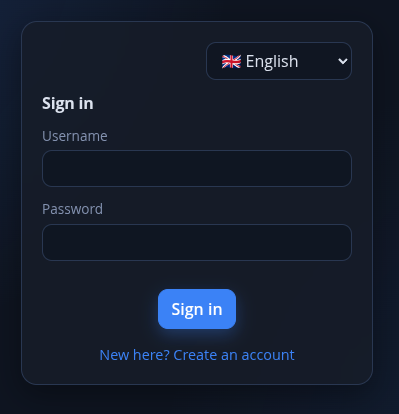

*Sign in page — use it after creating the account.*

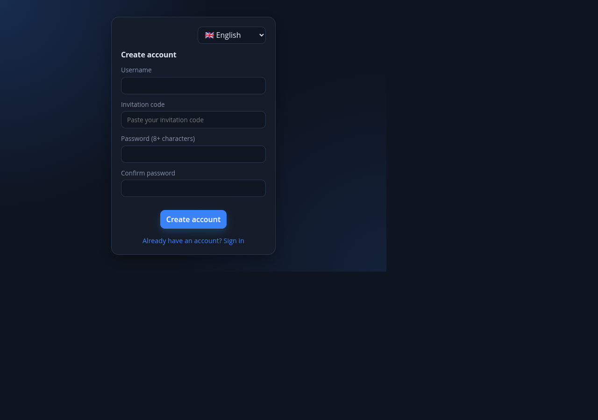

*Create account page. For the very first account the invitation code is not needed; everyone after that receives a single-use code from an admin.*

After that, create **device tokens** on the [profile page](#114-profile-password-tokens-invitations) — each device gets its own token.

### 4.2 The device

```sh
# Relay: local web UI + API on :8085, watches interfaces, reloads srtla_send
sudo bun backend/client/client.ts --host 0.0.0.0

# Encoder: pick a pipeline and the relay's SRT port in the UI
bun backend/client/client.ts --role encoder --pipelines /usr/share/belacoder/pipelines

# Combined
sudo bun backend/client/client.ts --role combined --pipelines /usr/share/belacoder/pipelines

# Relay: also start srtla_send immediately on startup
sudo bun backend/client/client.ts --start-srtla 6000 rec.example.com 5000
```

Open `http://<device>:8085/`. **A fresh device (no config file yet) opens on the setup wizard** — walk through it in [section 5](#5-first-run-setup-wizard). Connecting the device to the control server:

```sh
# on each device — that device's owner token
CONTROL_SERVER_TOKEN=tok-alice-1 bun backend/client/client.ts --role encoder --remote wss://ctl.example.com/device
```

> [!NOTE]
> Use the environment variable `CONTROL_SERVER_TOKEN` (not `REMOTE_TOKEN`) — it is the variable the client reads. Placing assignments **after** `sudo` passes them to the command without a persistent shell environment.

### 4.3 Production deployments

#### systemd

Run the compiled binaries (`bun run build:client` / `bun run build:server`) as a service. Example device unit (`/etc/systemd/system/irlctrl.service`):

```ini
[Unit]
Description=IRLCTRL device
After=network-online.target
Wants=network-online.target

[Service]
ExecStart=/usr/local/bin/bun /opt/irlctrl/client --config /var/lib/irlctrl/config.json
Restart=always
User=root

[Install]
WantedBy=multi-user.target
```

The control server uses the same pattern with `server` (no `root` needed). Put role, control-server URL/token, and binary overrides in the config file (`--config`) or an `EnvironmentFile` — the device keeps its state in the `--config` path, which autostart needs to survive a reboot.

#### Docker

`docker-compose.yaml` runs the whole stack — the control server plus a relay, an encoder, and an OBS Studio proxy:

```sh
docker compose up -d --build
```

- **server** — the control server (`Dockerfile`, image `majkl/irlctrl-control`), UI on `:8090`.
- **obs-client** — proxies a host's OBS Studio (`ws://host.docker.internal:4455`) into the server.
- **relay** — `client.ts --role relay`, bonds SRT out via `srtla_send` (`Dockerfile.device`, image `majkl/irlctrl-device`).
- **encoder** — `client.ts --role encoder`, runs `ceracoder`/GStreamer and sends SRT to the relay; same device image, different role + `ENCODER_BIN`.

The **relay** container grants the `NET_ADMIN` capability because at startup it builds per-uplink policy routing (`ip rule add` + route tables) and watches interfaces with `ip monitor`; without it the relay logs `ip rule add … Operation not permitted` and exits. The encoder does not need the capability. On the default bridge network the relay's routing changes act on the container's own namespace; for real bonded uplinks on the host's raw interfaces run the relay with `network_mode: host`.

#### Armbian image (Orange Pi 5 Plus)

The [`armbian/`](../armbian/) directory builds a ready-to-stream Armbian image with the whole streaming chain preinstalled (GStreamer incl. Rockchip plugins, CERALIVE's SRT, ceracoder, srtla_send, udev rules) so `client.ts --role combined` runs out of the box.

---

## 5. First-run setup wizard

A fresh device opens on a **setup wizard** instead of the normal UI. The wizard has one step per topic; for the *combined* role the full order is **Language → Device role → Identity → Control server → Encoder → Relay → Review** (encoder-only devices skip the Relay step, relay-only devices skip the Encoder step).

**Save validates everything, writes the initial config file, dials the control server, and brings the role up.** From then on the normal UI is shown and the wizard is never offered again.

### Step 1 — Language

Pick the interface language (12 languages are available). It can be changed at any time from the language select in the header.

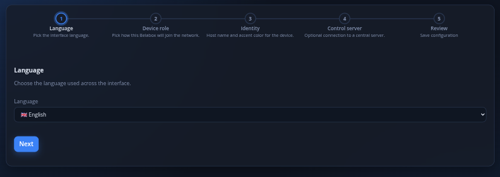

### Step 2 — Device role

Choose how this IRLCTRL joins the network. The three choices show exactly what each does:

- **Relay** — "Receives streams and forwards them with SRTLA"
- **Encoder** — "Captures a GStreamer pipeline and sends it over SRT"
- **Combined** — "Encodes and relays in a single service"

Selecting *Combined* inserts the Encoder and Relay steps into the wizard (7 steps total, as in the screenshot).

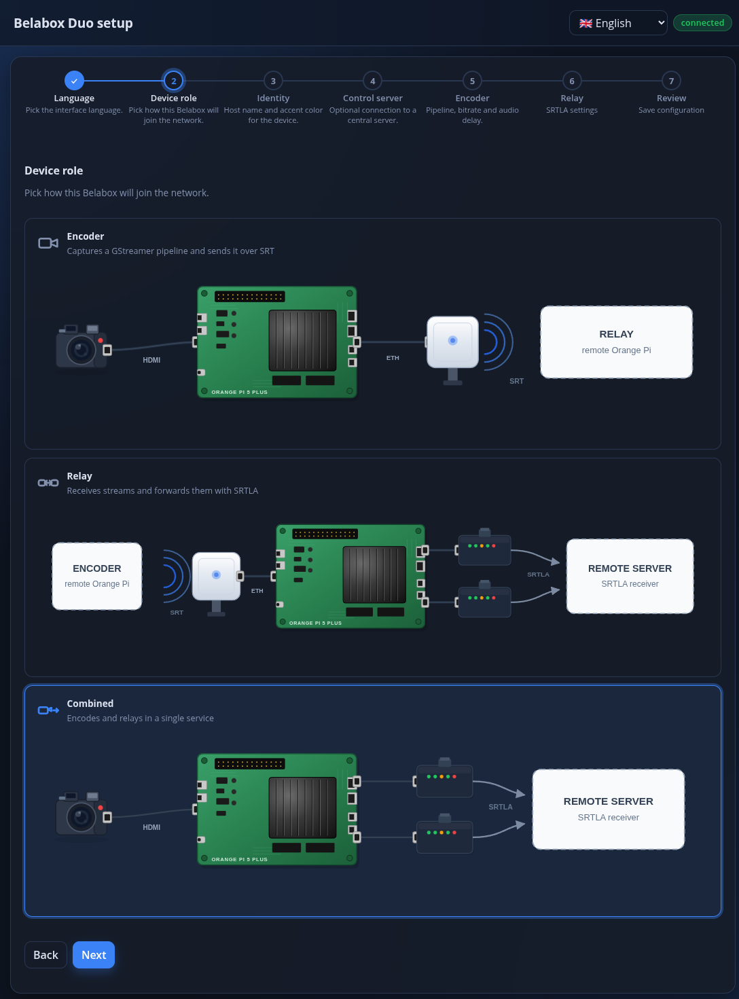

### Step 3 — Identity

How the device identifies itself to the control server:

- **Device name (hostname)** — lowercase letters, numbers, dots and hyphens, max 64 characters.
- **Accent color** — the header color of the device UI.

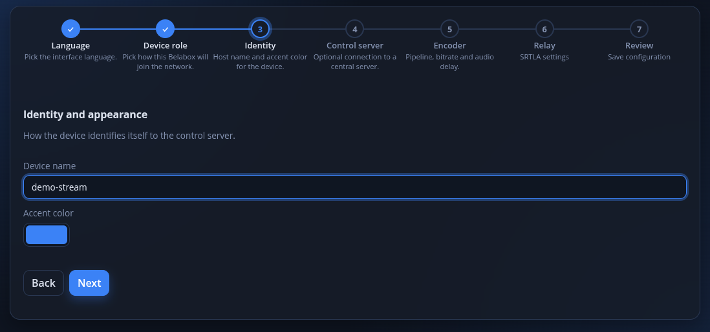

### Step 4 — Control server

Optional connection to a central server:

- **Control server URL** — e.g. `ws://192.168.1.10:8090/device` (or `wss://…` behind TLS).
- **Control token** — one of the device tokens minted on the owner's profile page. Leave both empty to run standalone (local UI only).

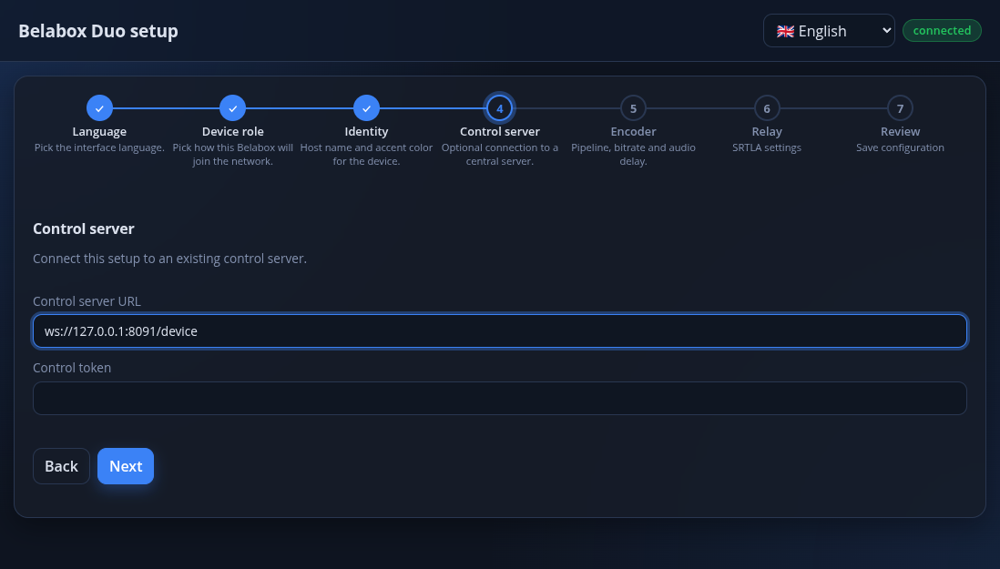

### Step 5 — Encoder

Encoder-specific fields for the capture pipeline:

- **Pipeline** — one of the GStreamer pipeline files under `--pipelines`, grouped by subdirectory (e.g. `generic/h265_v4l_mjpeg_1080p`). The list is preselected from disk; see [Encoder options](#8-encoder-options-explained) for what the rest of the fields mean.
- **Min / Max bitrate (kbps)** — the live video bitrate window (defaults 300 / 5000).
- **Audio source** — which ALSA audio card to capture ("Pipeline default" keeps whatever the pipeline says).
- **Audio codec** — AAC or Opus.
- **Audio delay (ms)** — audio-to-video alignment offset.
- **SRT latency (ms)** — SRT transmission latency (default 2000).
- **Stream ID** (optional) — the SRT stream ID announced to the receiver.
- **Bitrate overlay** — draws the current bitrate on the stream.

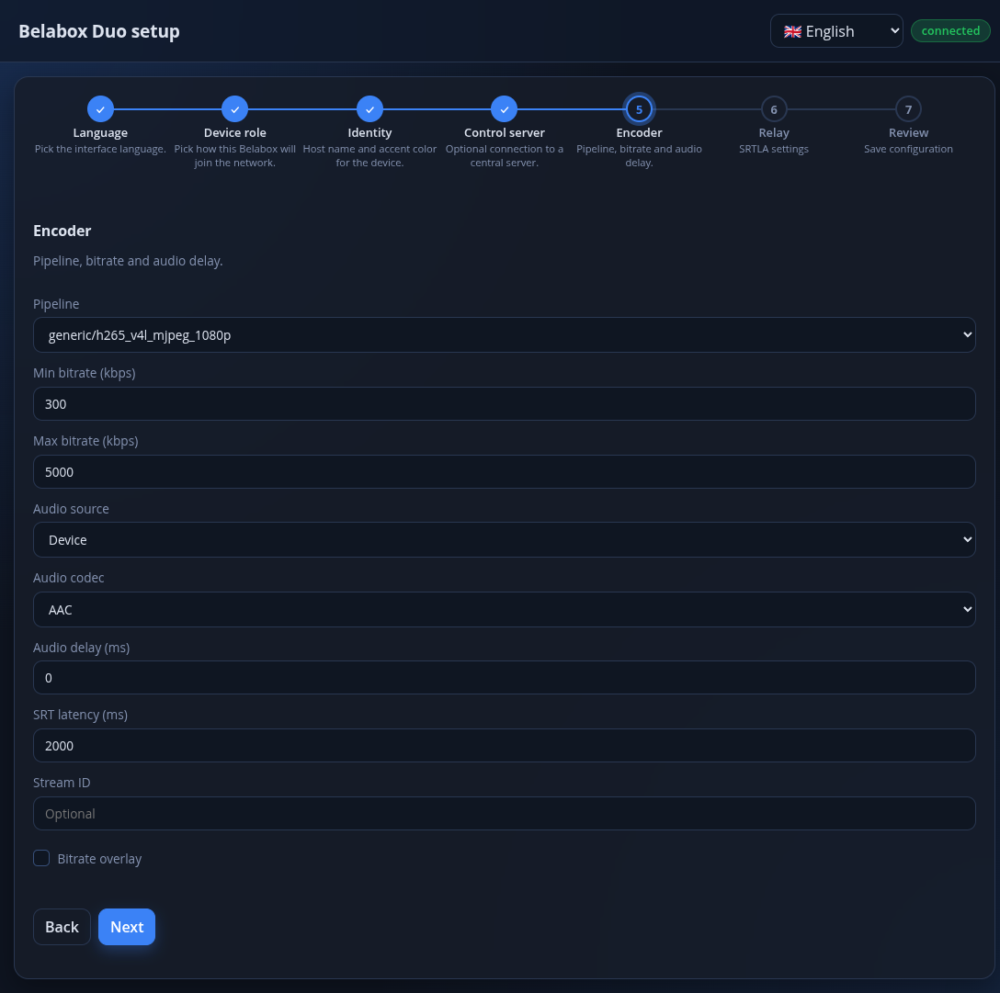

### Step 6 — Relay

SRTLA relay fields (relay/combined roles only):

- **SRT Listen port** — the port the encoder sends SRT to (default 6000).
- **SRTLA Remote host / port** — the bonded uplink target, e.g. `rec.example.com:5000`.
- **Scheduler** — `Enhanced` (default) or `Classic` link-scheduling algorithm.
- **Quality scoring** — SRTLA scoring used for best-link selection.

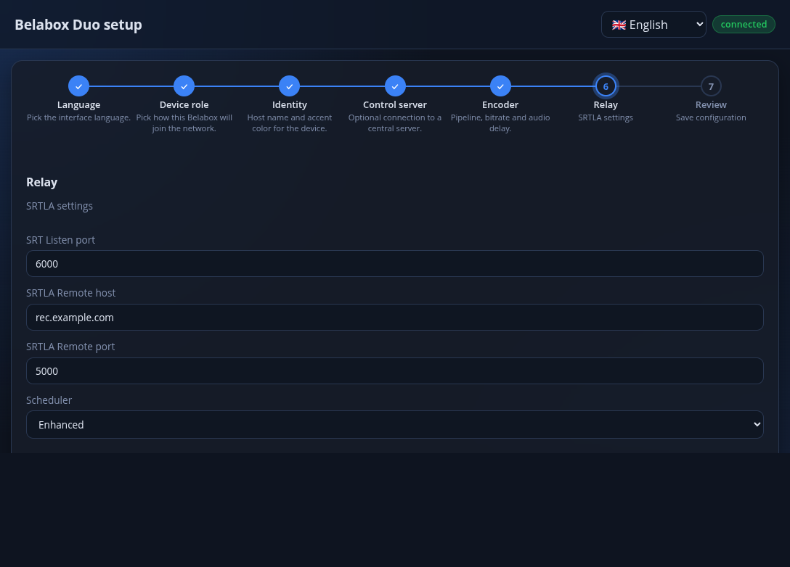

### Step 7 — Review & save

Review all choices (go back to change anything), then:

- **Autostart** — "Start the saved stream automatically after restart."
- **Save configuration** — writes the config, dials the control server, brings the role up.

The confirmation reads: *"Configuration saved. Restart the service to apply the selected role, hostname and control server."*

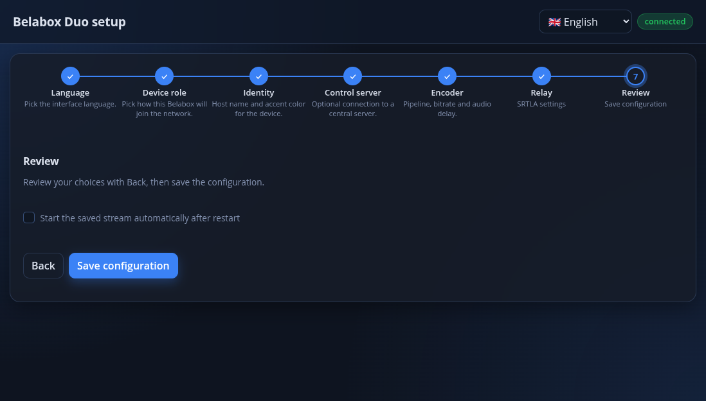

After saving, the normal device UI appears — [next section](#6-the-device-ui--daily-operation).

---

## 6. The device UI — daily operation

The main page (`http://<device>:8085/`) shows one card per capability of the active role. In the header you find: the **language select**, the **Autostart checkbox** ("Set startup to autostart or manual"), the **role badge**, the **connection status** to the control server, and the **Device settings** gear link.

### 6.1 Combined device (all cards)

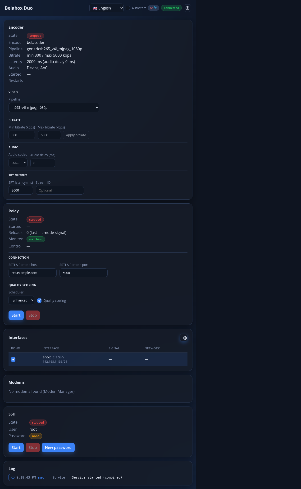
*Combined device: Encoder, Relay, Interfaces, Modems, SSH and Log cards.*

### 6.2 Encoder role

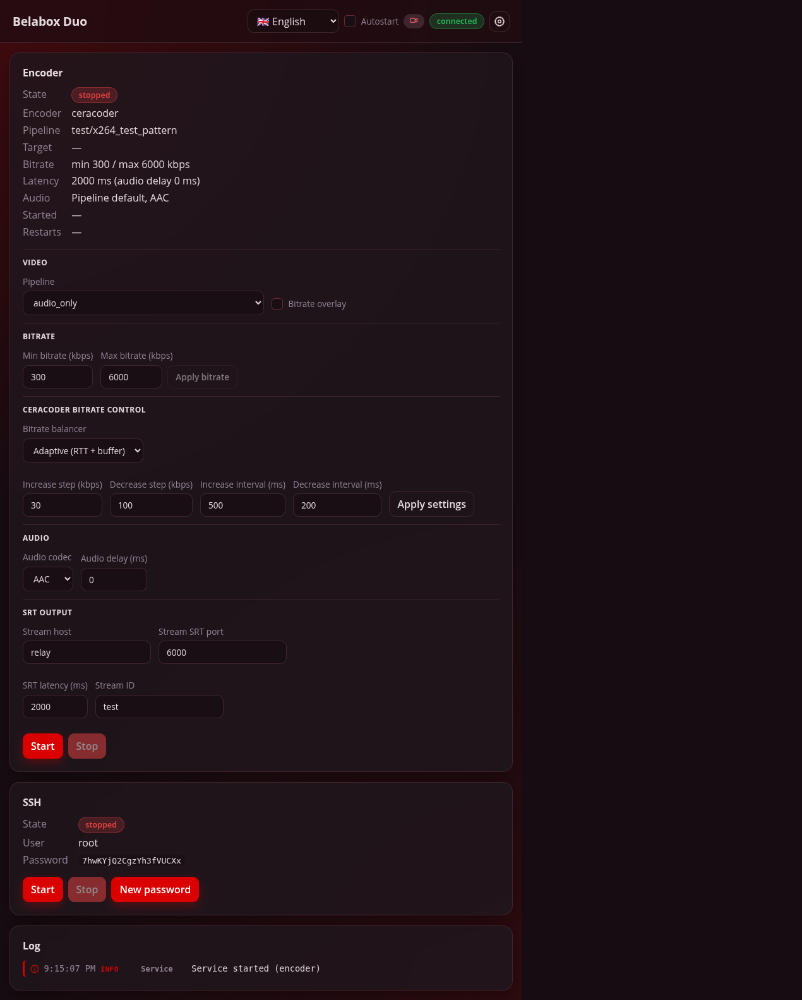
*Encoder role: the Encoder card with pipeline list — no relay/routing cards.*

### 6.3 Relay role

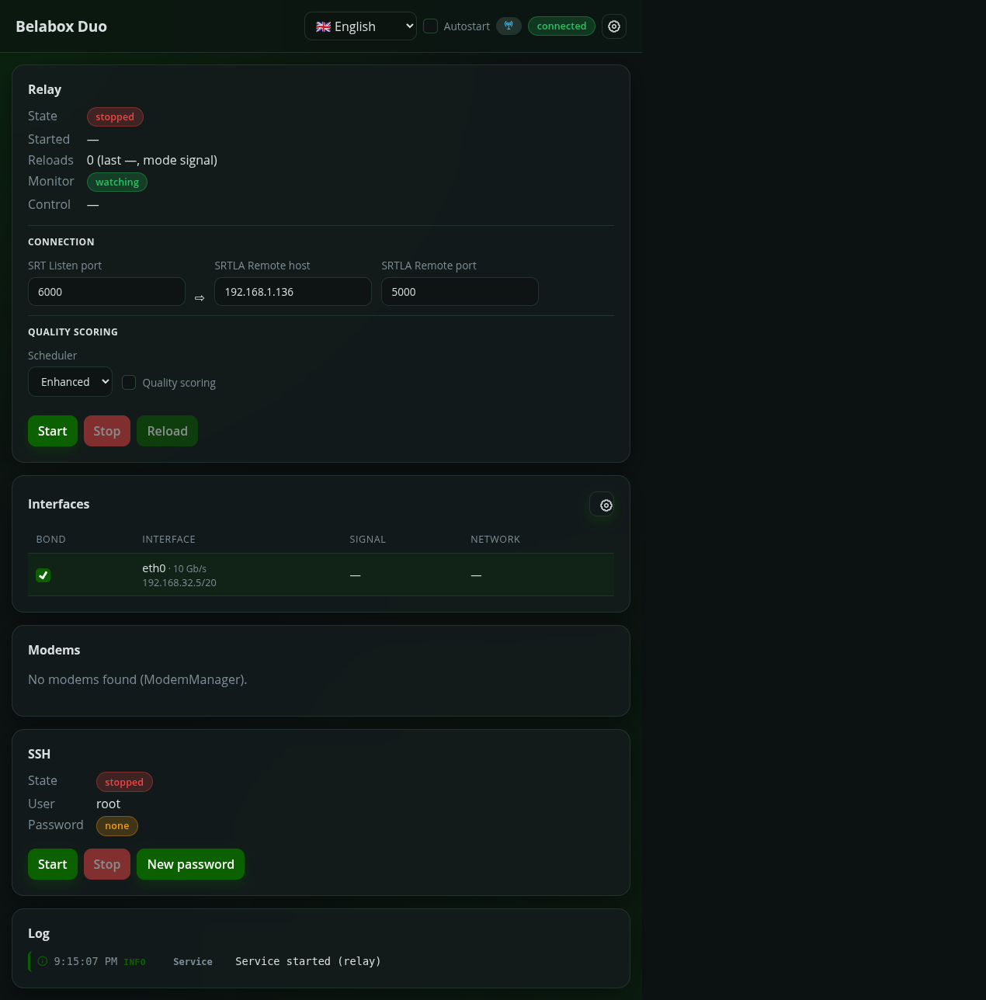
*Relay role: Relay card (connection + quality scoring), Interfaces, Modems, SSH, Log.*

### 6.4 Encoder card

| Field / group | Meaning |
| --- | --- |
| **State** | `stopped`, `running`, `restarting`. |
| **Encoder** | Which binary is used — `belacoder` or `ceracoder` (auto-detected by name). |
| **Pipeline** | Currently selected pipeline, e.g. `generic/h265_v4l_mjpeg_1080p`. Change from the list below. |
| **Target** | (standalone encoder only) the SRT endpoint the stream is sent to: `host:port / stream ID`. |
| **Bitrate** | `min 300 / max 5000 kbps` — editable; **Apply bitrate** pushes the change to the running encoder (belacoder re-reads its bitrate file on SIGHUP). |
| **Latency** | `2000 ms (audio delay 0 ms)` — SRT latency + audio delay. |
| **Audio** | Audio source + codec (`AAC`/`Opus`). |
| **Started / Restarts** | Since when the stream runs; how many times it auto-restarted. |
| **Ceracoder bitrate control** | *ceracoder only* — the balancer: **Adaptive (RTT + buffer)**, **AIMD (TCP-style)** or **Fixed bitrate**, with increase/decrease steps (kbps), increase/decrease intervals (ms) and a congestion multiplier (0–1). **Apply settings** applies them live. |
| **Start / Stop** | Starts/stops the encoder process. |

### 6.5 Relay card

| Field / group | Meaning |
| --- | --- |
| **State** | `stopped` / `running`; badge `srtla_send down` if the process died. |
| **Started** | Since when the relay runs. |
| **Reloads** | `N (last <when>, mode <signal\|restart>)` — how many times `srtla_send` was reloaded. |
| **Monitor** | `watching` — the interface monitor is active. |
| **Control** | status of the `srtla_send` control socket (link stats, mode/quality). |
| **Connection** | **SRT Listen port** (where encoders connect), ⇨, **SRTLA Remote host**, **SRTLA Remote port** (the bonded uplink target). Edits are applied live. |
| **Quality scoring** | **Scheduler** `Enhanced`/`Classic` + **Quality scoring** checkbox — SRTLA scoring for best-link selection. |
| **Start / Stop / Reload** | Start/Stop the whole bonded send; **Reload** re-reads the uplinks (SIGHUP or full restart depending on `--srtla-reload`). |

### 6.6 Interfaces card

Per network interface: **Bond checkbox** ("Include in bond" — the uplinks that `srtla_send` will bond), **Interface** name + speed (e.g. `eth0 · 10 Gb/s`) and CIDR, **Signal** (for modem interfaces), **Network** (the policy-routing table it maps to). The **Reconfigure** button reapplies routing after changes.

### 6.7 Modems card

Shows every ModemManager modem: IMEI, operator, registration, signal — with actions to **enable / disable / connect / disconnect / reset** each one. Modems appear as `modem #N` entries in the Interfaces card's bond selection. With no modems: *"No modems found (ModemManager)."*

### 6.8 SSH card

Manages this box's SSH server: **State** (`stopped`/`running`), **User** (login account, default `root`), **Password** (`none` / `configured`), and buttons **Start** / **Stop** / **New password** (a password can only be generated while SSH is stopped).

### 6.9 Log card

A persistent event log — every action (configuration changes, bitrate changes, bond toggles, module starts/stops, modem events) with a timestamp and severity. It is written to `--log-file` and survives restarts.

### 6.10 Autostart

Tick **Autostart** in the header (or call `autostart.set`) to resume the last stream whenever the service starts. It **retries every 5 s** until it succeeds (capture card, uplinks, or receiver not ready yet); any manual Start/Stop cancels a pending retry.

---

## 7. Device settings page — every option

Open the gear icon in the device header → **Device settings**. The notice at the top explains the two save behaviors:

> *"Settings are re-applied on the control server after saving."* and
> *"The new role takes effect after restarting the device service."*

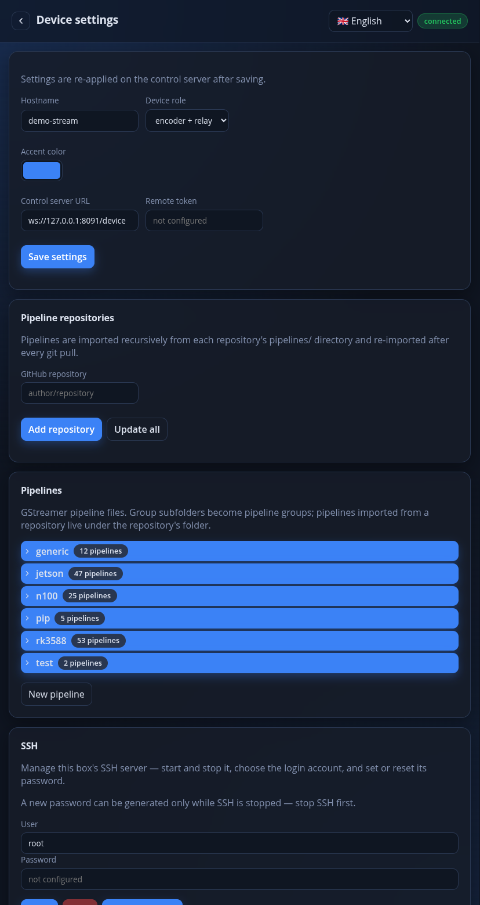

| Option | Meaning |
| --- | --- |
| **Hostname** | The device's display name (lowercase letters, numbers, dots and hyphens, max 64 chars). The UUID — the fixed identity on the control server — stays unchanged and survives hostname changes. |
| **Device role** | `relay` / `encoder` / `encoder + relay (combined)` / `obs`. Changing the role requires a service restart. |
| **Accent color** | Header color of the device UI. |
| **Control server URL** | `ws://…`/`wss://…` endpoint of the control server (`…/device`). Saving re-dials the control server, so the device re-registers with its new URL, token, hostname and role without a service restart. |
| **Remote token** | Device token of the owning user. Placeholders: `configured (leave blank to keep)` / `not configured`. |
| **Save settings** | Persists everything and re-applies it on the control server. |

### 7.1 Pipelines

GStreamer pipeline files on the device. **Group subfolders become pipeline groups** (e.g. `generic/`, `jetson/`, `rk3588/`, `n100/`, `pip/`, `test/`); pipelines imported from a repository live under the repository's folder. Each group shows its pipeline count with **New pipeline / Edit / Delete** actions. The pipeline manager lists, creates, edits and deletes the files on disk.

**Pipeline editor** (at `/pipelines/new/`, or *Edit* on an existing one):

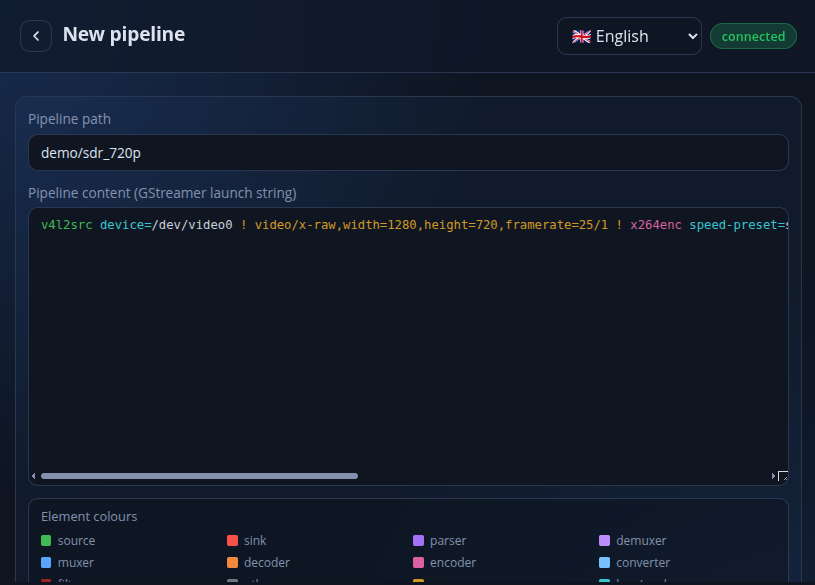

- **Pipeline path** — `group/name` (e.g. `test/x264_test_pattern`). New files are written under `--pipelines` at that path.
- **Pipeline content** — the GStreamer launch string, with syntax highlighting. **Element colours** legend: source, sink, parser, demuxer, muxer, decoder, encoder, converter, filter, other, caps, key-pad, value.
- **Save (Ctrl+S)** — a file must contain a non-empty GStreamer launch string (at least one `!` between elements) to be saved.

> Every pipeline must match the available hardware and GStreamer plugins on the device — e.g. Rockchip pipelines use `mpph265enc`, which is not available on a generic x86 host. If the UI reports *Pipeline is empty*, select another pipeline or restore the file.

### 7.2 Pipeline repositories

Pipelines can be imported from GitHub:

- **Add repository** — `author/repository` format. Files below the repository's `pipeline/` directory are **imported recursively** into `PIPELINES_DIR/author/repository/` and re-imported after every git pull.
- Each repository shows a **pipeline count** badge with:
  - **Update** — refresh just that repository.
  - **Update all** — refresh every configured repository, replacing local files so deleted upstream pipelines are removed too.
  - **Remove** — remove the repository *and* its imported pipeline files.

### 7.3 OBS connection

*Connection to OBS Studio used by the obs-controller module. The module is restarted after saving.*

- **OBS WebSocket URL** — e.g. `ws://127.0.0.1:4455`.
- **OBS password** — the password configured in OBS Studio (Settings → General/Stream). Leave blank to keep the current one.

### 7.4 SSH

*Manage this box's SSH server — start and stop it, choose the login account, and set or reset its password.*

- **User** — the login account (default `root`).
- **Start / Stop** — the SSH server.
- **New password** — generates a fresh password; the new value is shown once. *A new password can be generated only while SSH is stopped — stop SSH first.*

---

## 8. Encoder options explained

Every option an encoder exposes (wizard step, encoder card, settings):

| Option | What it means |
| --- | --- |
| **Pipeline** | The GStreamer launch string belacoder/ceracoder will run. Pipeline ids are paths under `--pipelines`, e.g. `rk3588/h265_hdmi_1440p25`. Before launch the pipeline is adapted the way belaUI does (audio card selection, AAC→Opus switching, …). |
| **Min bitrate (kbps)** | Lower bound of the live video bitrate window. |
| **Max bitrate (kbps)** | Upper bound of the live video bitrate window. For **belacoder** the change is written to the bitrate file and re-read on SIGHUP — no restart needed. |
| **Audio source** | ALSA audio card to capture. `Pipeline default` keeps whatever the pipeline defines; picking a specific card rewires the audio source element. |
| **Audio codec** | `AAC` or `Opus` — the audio encoder used in the outgoing SRT stream. |
| **Audio delay (ms)** | Offset applied to the audio track to align it with the video. |
| **SRT latency (ms)** | SRT transmission latency for the encoder→relay link (default 2000 ms). |
| **Stream ID** (optional) | The SRT stream ID announced to the receiver; leave empty for untagged SRT. |
| **Bitrate overlay** | Draws the current live bitrate onto the video. |
| **Stream host / SRT port / Stream ID** (standalone encoder only) | The relay's SRT endpoint the encoder sends to. |
| **Bitrate balancer** (ceracoder only) | `Adaptive (RTT + buffer)` — adjusts bitrate from RTT and buffer pressure; `AIMD (TCP-style)` — additive-increase/multiplicative-decrease like TCP congestion control; `Fixed bitrate` — constant. |
| **Increase step (kbps) / Increase interval (ms)** (ceracoder) | How much and how often the balancer may raise the bitrate. |
| **Decrease step (kbps) / Decrease interval (ms)** (ceracoder) | How much and how often the balancer may lower the bitrate. |
| **Congestion multiplier (0–1)** (ceracoder) | How aggressively the bitrate is multiplied down on congestion (1 = hard, 0 = no cut). |

---

## 9. Relay / SRTLA options explained

| Option | What it means |
| --- | --- |
| **SRT Listen port** | The port the relay listens on for the encoder's SRT stream (default 6000). |
| **SRTLA Remote host** | The bonded uplink destination — the SRTLA receiver's host name/IP. |
| **SRTLA Remote port** | The receiver's port (default 5000). |
| **Scheduler** | `Enhanced` (default) — the improved SRTLA link-scheduling algorithm; `Classic` — the original scheduler. Applied live over the control socket. |
| **Quality scoring** | Enables SRTLA scoring for best-link selection — links are rated (share of total throughput, min RTT, quality markers like `up` / `weak` / `stalled` / `timed out`) and the scheduler uses the score to weight data per link. |
| **Bond (per interface)** | Which interfaces participate in the bonded send. On startup the relay builds per-uplink policy routing (`ip rule` + route tables) so each uplink leaves through its intended interface; the **Reconfigure** button reapplies it. |
| **Reload mode** | `signal` (SIGHUP — fast, re-reads uplinks file) vs `restart` (full process restart) after `--srtla-reload` / the UI Reload button. |
| **Uplinks file** | `--uplinks` file consumed by `srtla_send` (one IP per participating uplink). |
| **Control socket** | `--srtla-socket` used for live link stats and mode/quality changes; `""` disables it. |
| **Start / Stop / Reload** | Lifecycle of the `srtla_send` process; one Start/Stop in *combined* drives encoder + relay together. |

> [!IMPORTANT]
> The relay needs root (or the `NET_ADMIN` capability in Docker) to create the policy routes; without it it logs `ip rule add … Operation not permitted` and exits.

---

## 10. OBS Studio module & low-bitrate switcher

The **obs-controller** module owns the [obs-websocket](https://github.com/obsproject/obsproject/obs-websocket) (v5) connection to a paired OBS Studio instance and forwards its events into the device event stream. Configure it in **Settings → OBS connection** (URL + password; the module is restarted after saving). Its module config form offers:

| Option | Meaning |
| --- | --- |
| **OBS WebSocket URL** / **Password** | Connection to OBS Studio (leave blank to keep the stored password). |
| **Subscribe to scene events** | Also forward scene-change events (used by dashboards and the switcher). |

The OBS Studio card then shows: **Current scene**, **Scene list** (with per-scene switch buttons), **Streaming** / **Recording** / **Studio mode** state, **Output** (mic live/muted + mute/unmute), **Audio level**, and **Start/Stop stream**, **Start/Stop recording**, **Screenshot**, **Refresh**.

### 10.1 Low-bitrate switcher

A state machine that watches the SRT/OBS metrics and automatically switches OBS between **normal / low / offline** scenes when the uplink degrades:

| Group | Option | Meaning |
| --- | --- | --- |
| — | **Low-bitrate switcher** (checkbox) | Master on/off. *No engine running yet. Set the OBS SRT source above, pick the scenes, and save — the switcher starts once its config is stored.* |
| — | **OBS SRT source** | Name of the SRT input in OBS whose stats drive the switcher. If no stats arrive: *No SRT stats from OBS — check that obs-websocket 5 is loaded and the source name matches the SRTLA source in OBS.* |
| Triggers | **Low bitrate (kbps)** | Below this SRT bitrate → switch to the low-bitrate scene. |
| Triggers | **Offline bitrate (kbps)** | Below this → the link is considered down → offline scene. |
| Triggers | **RTT (ms)** | Round-trip time above this counts as degraded. |
| Triggers | **Retry attempts** | How many failed polls before the degradation is accepted. |
| Triggers | **Poll interval (ms)** | How often SRT stats are read. |
| Triggers | **Automatic switching** | Allow the engine to switch scenes by itself. |
| Triggers | **Switch back instantly on recovery** | Return to the normal scene as soon as quality recovers (instead of waiting out a hysteresis window). |
| Triggers | **Only switch while streaming** | Don't switch scenes during idle time. |
| Triggers | **Write log to file** | Persist the switcher's decision log. |
| Scenes | **Normal** | The scene used at full quality. |
| Scenes | **Low bitrate** | The scene used when the trigger fires. |
| Scenes | **Offline** | The scene used when the link is down. |
| Scenes | **Starting (optional)** / **Ending (optional)** | Scenes shown for the transition in/out. |
| Scenes | **Privacy (optional)** | Scene shown while the offline condition persists (e.g. "be right back"). |

The status table tracks the engine per link: **State** (`normal` / `low bitrate` / `offline` / `idle`), **SRT bitrate**, **SRT RTT**, **Desired** (target scene), **Program scene**, **retry** counter and **Last update**.

---

## 11. Control server operation

Start it (`bun backend/server/server.ts --port 8090`), sign in, and manage the fleet.

### 11.1 Device list

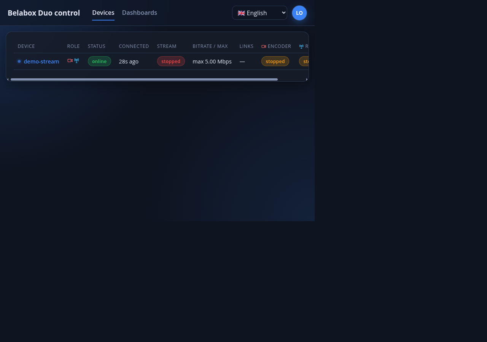

The table shows every device owned by the signed-in user:

| Column | Meaning |
| --- | --- |
| **Device** | Hostname + UUID. |
| **Role** | `relay` / `encoder` / `encoder + relay` / `obs` (badges). |
| **Status** | `online` / `offline` (with *last seen* time), `stale` if it stopped reporting. |
| **Connected** | Live WebSocket connection of the device. |
| **Stream** | `streaming` / `stopped` / `no links` badge. |
| **Bitrate / max** | Current live bitrate vs. the configured max. |
| **Links** | Bonded uplinks: per-link share of total throughput, min RTT, quality (`up` / `weak` / `stalled` / `timed out` / `sole carrier`). |
| **Encoder / Relay** | State chip for each half. |

Click a device to open its **device page**.

### 11.2 Device page (`/d/<id>/`)

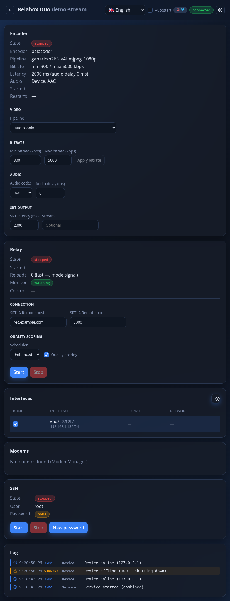

The device page renders the **same cards** as the device's own UI (Encoder, Relay, Interfaces, Modems, SSH, Log) but is served by the control server, which relays every command to the device over its outbound connection — so you can operate devices behind NAT or on mobile networks from anywhere. It additionally has the **Autostart** checkbox and a **Device settings** link in its header. All start/stop/reload/configure actions work exactly as described in [section 6](#6-the-device-ui--daily-operation).

### 11.3 Profile — password, tokens, invitations

Reach it from the username menu in the header.

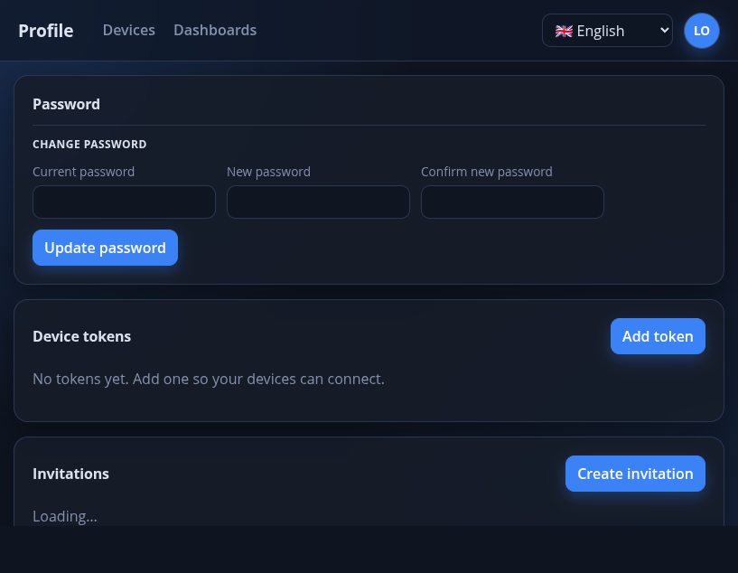

- **Change password** — current password + new password (8+ chars) + confirmation.
- **Device tokens** — **Add token** mints a fresh token; **click to copy** the value; **Remove** revokes. *"No tokens yet. Add one so your devices can connect."* Each device you want to manage should connect with one of your tokens (`--remote-token` / `CONTROL_SERVER_TOKEN`).
- **Invitations** (admin only) — **Create invitation** mints a single-use code (optionally with an expiry) that someone pastes into the [register page](screenshots/02-register.png). *"No invitations yet. Create one so someone can join."*

### 11.4 Dashboards

Per-user, persisted to SQLite, live-updating (a shared feed streams widget data to every open view).

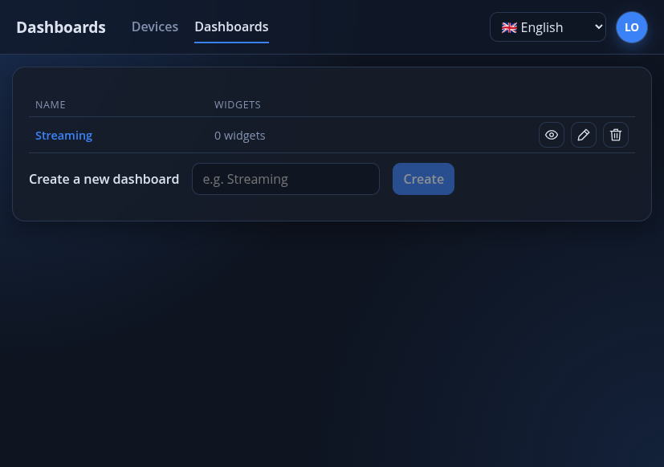

- **Create a new dashboard** — type a name (e.g. *Streaming*) and press **Create**.
- Each row: **Name** (links to the view page), **Widgets** count, and **View / Edit / Delete** actions.

**Add widget** — pick a type:

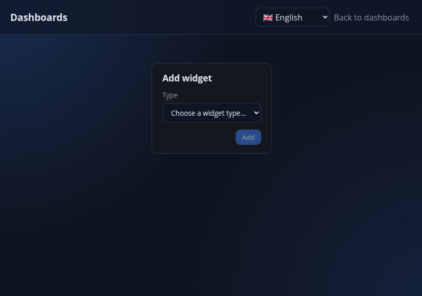

Widgets are of two kinds:

- **Device widgets** — a live status card per device: `relay`, `encoder`, `combined`, or `obs`, depending on the device's role and enabled modules. The type list shows one entry per connected device (e.g. *Combined*).
- **Channel widgets** — device-independent: **Stats** (YouTube/Twitch/Kick viewer counts) and **Chat** (merged chat feeds).

**Dashboard view page:**

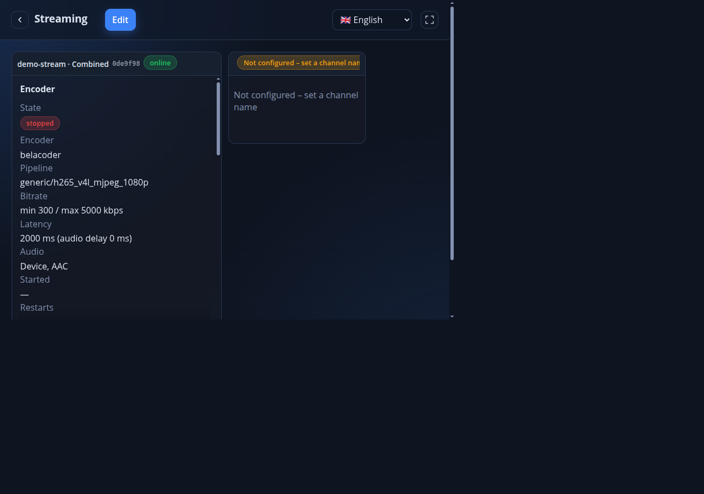

**Edit page / view page options:**

| Option | Meaning |
| --- | --- |
| **Rename** | Inline name field in the edit header. |
| **+ Add widget / Remove (×)** | Add or delete widgets. |
| **⠿ drag handle** | Rearrange widgets in the grid. |
| **Width: third / half / full** | Widget grid width (4 / 6 / 12 columns). |
| **Move up / Move down** | Reorder widgets vertically. |
| **New messages: On top / At the bottom** | Chat message insertion order. |
| **History lines** | How many chat messages are buffered/rolled back. |
| **Channel settings** (chat/stats widgets) | **YouTube channel** (channel ID or handle), **Twitch channel**, **Kick channel** — configured independently; stats polls each source every 30 s and charts viewer counts plus the combined total (1 h window). *Not configured – set a channel name* until filled in. A **TikTok channel** and an independent **Kick (independent)** variant are also available. |
| **Enter fullscreen / Exit fullscreen** | Fullscreen the whole dashboard. |
| **Done** | Leave edit mode back to the view. |
| **Hide** | Hide a widget's content area. |

A widget for a device whose module is off shows *Module disabled on device*; a widget whose device vanished shows *No device*.

---

## 12. Command-line reference

### 12.1 Device client (`backend/client/client.ts`)

| Option | Env | Default | What it does |
| --- | --- | --- | --- |
| `--role` | `ROLE` | `relay` | `relay`, `encoder`, or `combined`. |
| `--host`, `--port` | — | `127.0.0.1`, `8085` | Local web UI and WebSocket API (`/ws`), always on. |
| `--allow-origin` | — | — | Extra browser origins for `/ws` (comma-separated, `*` = any). |
| `--config` | — | `$TMPDIR/config.json` | Device config — settings, encoder, srtla target, autostart, modems. **Use a persistent path in production** (autostart needs it to survive a reboot). |
| `--uplinks` | — | `$TMPDIR/srtla_ips.txt` | Uplinks file for `srtla_send`. |
| `--start-srtla` | — | — | Relay/combined: start `srtla_send` on boot with `<listenPort> <remoteHost> <remotePort>`. |
| `--srtla-reload` | — | `signal` | How to reload `srtla_send`: `signal` (SIGHUP) or `restart`. |
| `--srtla-socket` | `SRTLA_CONTROL_SOCKET` | `$TMPDIR/srtla_send.sock` | `srtla_send` control socket (link stats, mode/quality); `""` disables it. |
| `--debounce-ms` | — | `1500` | Interface-event debounce in ms. |
| `--pipelines` | `PIPELINES_DIR` | `/usr/share/belacoder/pipelines` | Pipeline files, including subdirectories. |
| `--encoder` | `ENCODER_BIN` | `belacoder` | Encoder binary; `ceracoder` is detected by name and switches the encoder module to INI-config mode. |
| — | `SRTLA_SEND_BIN` | `srtla_send` | Path to the `srtla_send` binary. |
| `--bitrate-file` | — | `$TMPDIR/belacoder_br` | belacoder bitrate file (re-read on SIGHUP). |
| `--ceracoder-conf` | — | `$TMPDIR/ceracoder.conf` | ceracoder INI config (balancer + tuning), applied live by the encoder module. |
| `--log-file` | — | `$TMPDIR/srtla_log.json` | Persistent event log shown in the web UI. |
| `--remote` | `CONTROL_SERVER_URL` | — | Control server, e.g. `wss://ctl.example.com/device`. The env var overrides the config file (CLI flag overrides both). |
| `--remote-token` | `CONTROL_SERVER_TOKEN` | — | Device token. **Prefer the env var** (keeps it out of `ps`); the env var overrides the config file. |
| `--remote-interval` | — | `30` | Periodic status push in seconds (`0` = only on change). |
| `--remote-stats-interval` | — | `2` | `srtla_send` link-stats push interval in seconds. |
| `--dry-run` | — | — | Print `ip`/process actions instead of running them (safe testing). |

### 12.2 Control server (`backend/server/server.ts`)

| Option | Env | Default | What it does |
| --- | --- | --- | --- |
| `--host`, `--port` | — | `0.0.0.0:8090` | Listen address. Run behind a TLS reverse proxy in production (device tokens and the session cookie need `wss://`/`https://`). |
| `--db` | `SRTLA_DB` | `users.db` | SQLite database: users, device tokens, dashboards. |
| `--no-auth` | — | — | Local testing only — one shared `local` profile, no tokens needed (no database; dashboards are kept in memory only). |

### 12.3 OBS client (`backend/obs-client/obs-client.ts`)

```
Usage: bun backend/obs-client/obs-client.ts --remote ws://host:port/device
    [--obs ws://127.0.0.1:4455] [--obs-password pw]
    [--remote-token pw] [--hostname name]
    [--config path] [--uuid uuid]
```

| Option | Meaning |
| --- | --- |
| `--remote` | The control server's `/device` endpoint (required). |
| `--remote-token` | The owning user's device token. |
| `--obs` | The host's OBS Studio WebSocket (default `ws://127.0.0.1:4455`). |
| `--obs-password` | OBS Studio password. |
| `--hostname` | Device name shown in the control server. |
| `--config` | Config file (persists UUID and settings). |
| `--uuid` | Explicit fixed device identity. |
| `--remote-interval` | Status push interval in seconds (default 30). |

It speaks the full obs-websocket v5 handshake (Hello → Identify → Identified), forwards `Request`/`RequestBatch` verbatim from the server, republishes OBS events as `obs.event` frames so dashboards pick up scene/stream/record changes, and auto-reconnects with exponential backoff (emitting a synthetic *ObsDisconnected* on drop and replaying a state snapshot on reconnect).

---

## 13. Troubleshooting

| Symptom | What to check |
| --- | --- |
| **Wizard doesn't advance** | Validation is silent — a required field is empty/invalid (hostname format, missing pipeline, ports). Fill every step's fields; selects start on a placeholder option that must be replaced. |
| **"Pipeline is empty"** | The selected pipeline file is empty or whitespace-only. Select another pipeline in the Encoder card or restore/create the file in Settings → Pipelines. |
| **Pipeline won't start** | Pipeline/hardware mismatch (e.g. Rockchip `mpph265enc` on x86) or missing GStreamer plugins. Pick a pipeline from a group matching your hardware. |
| **Relay exits: `ip rule add … Operation not permitted`** | Missing root / `NET_ADMIN`. Run as root (systemd) or add the capability in Docker. |
| **`srtla_send down` badge** | The send process died — check the Log card, fix the uplink target, press Start (or Reload). |
| **Encoder `restarting` forever** | Watch Restarts + Log card; usually a dead capture device or pipeline crash. |
| **Device shows `offline` on the control server** | Device not running, or URL/token wrong — the last push is shown with *last seen*. Fix `--remote` / `--remote-token` (or Settings → Control server URL / Remote token). |
| **"stale, …"** | Device connected but not reporting — network problem between device and server, or `--remote-interval`/`--remote-stats-interval` too long. |
| **No SRT stats in the switcher** | obs-websocket v5 not loaded in OBS, or the *OBS SRT source* name doesn't match the SRT input in OBS. |
| **Can't set a new SSH password** | Stop SSH first — a new password can be generated only while SSH is stopped. |
| **Register fails with invitation errors** | *inviteInvalid / inviteUsed / inviteExpired* — ask an admin for a fresh code; only the very first account registers without one. |
| **Device settings saved but role unchanged** | Expected: *"The new role takes effect after restarting the device service."* |
| **Docker relay doesn't bond the host's uplinks** | On the bridge network routing changes only affect the container namespace — run the relay with `network_mode: host`. |

### Common log events (Log card)

Configuration changes, `Bitrate set to min X / max Y kbps`, `Bond toggle` (`eth0 toggled in bond` / `Bond selection updated`), `Mode set to enhanced|classic`, module enabled/disabled/configured, modem connected/disabled/reset, pipeline created/updated/deleted — each with a timestamp and severity, persisted in `--log-file`.

---

*See also: [README](../README.md) for architecture and development, [modules/README.md](../modules/README.md) for the module system, and the i18n catalogs in `i18n/` for the 12 supported languages.*
